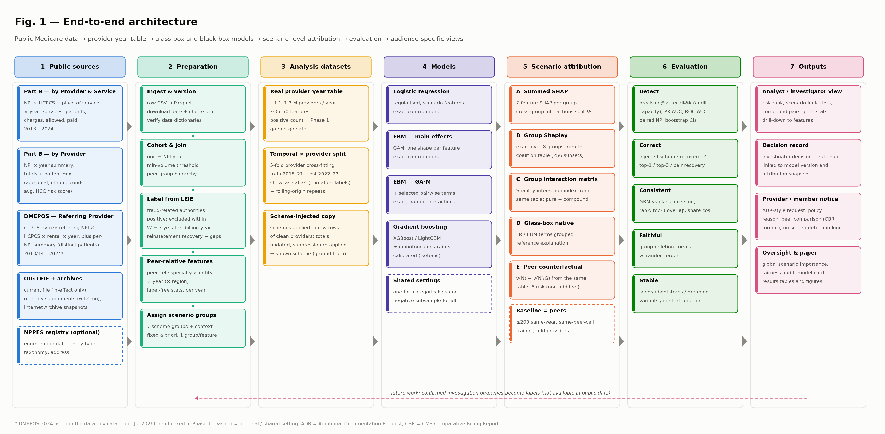
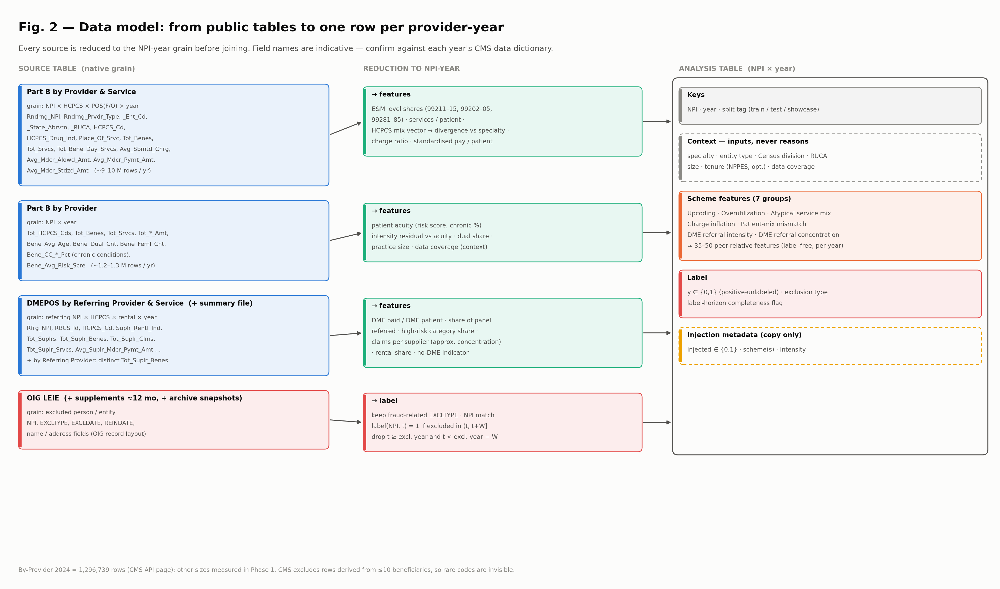
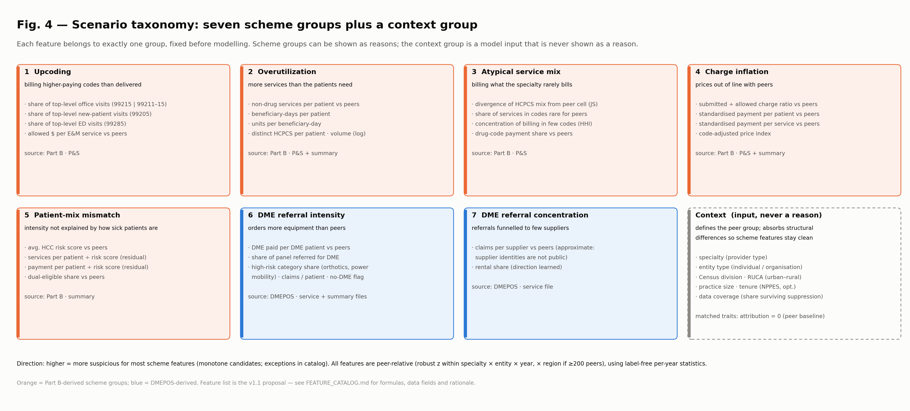
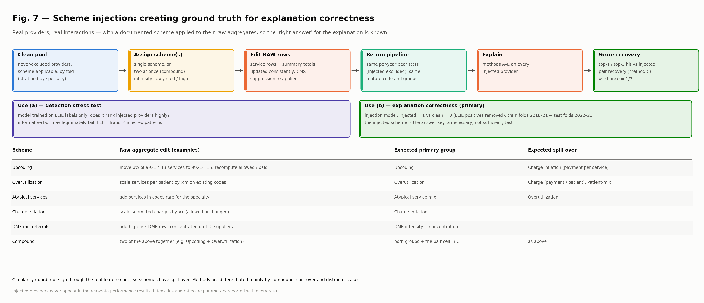
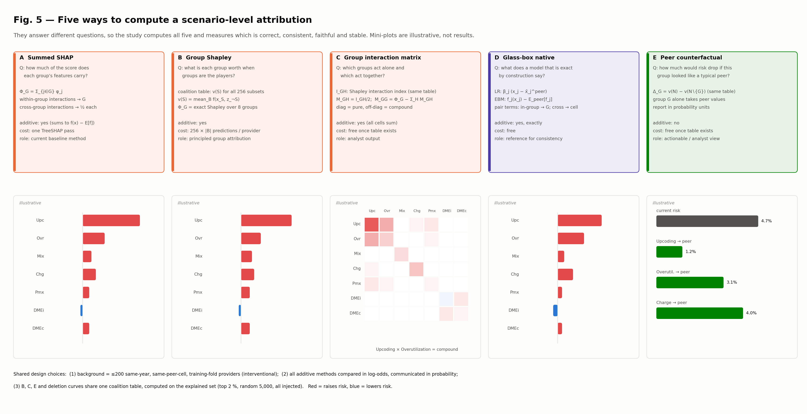
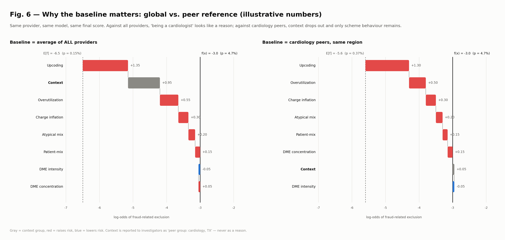
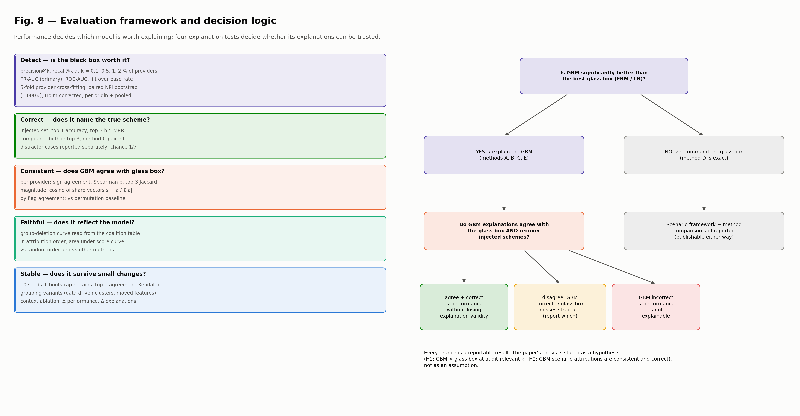
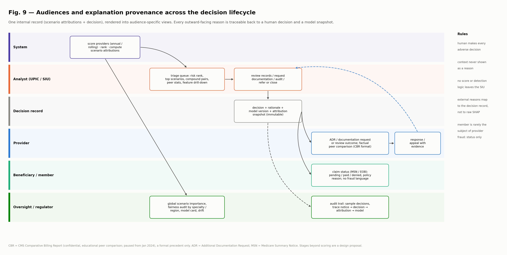

# Scenario-Level Explanations for Health-Care Fraud Detection on Public Medicare Data

**Design document · v1.1 · 11 October 2026**
Status: proposal, verified against primary sources where possible (see §18). Nothing has been built yet; this is the specification the build will follow.
Companion files: [FEATURE_CATALOG.md](FEATURE_CATALOG.md) · [EXPERIMENT_PLAN.md](EXPERIMENT_PLAN.md) · figures in [figures/](figures/)

**Changes from v1.0**, after a verification pass against CMS data dictionaries, OIG pages and the cited literature:

- Peer statistics are now **label-free and computed per year** (v1.0 contradicted itself by saying "fit on training years" and "year-specific").
- The single 80/20 provider split is replaced by **5-fold provider cross-fitting**. With the low positive rates reported in the literature, a 20 % test pool would leave too few positives.
- Method C (the interaction matrix) is now computed from the **same exact group-level calculation as method B**, at the group level. This removes its dependence on path-dependent TreeSHAP and makes it consistent with the peer baseline.
- The **reinstatement recovery plan is corrected.** OIG archives only about the last 12 months of supplement files, so historical recovery relies on Internet Archive snapshots, which have gaps.
- DMEPOS 2024 now appears to be published. The DMEPOS **by Referring Provider** summary file is added for distinct-beneficiary counts.
- The effects of **CMS small-cell suppression** on each feature are made explicit. One feature that can't be computed from public data was removed.
- Medicare fee-for-service actors and terminology are corrected (UPIC, ADR, MSN, Fraud Prevention System), and the policy framing is narrowed.
- New: §8 **Components to build**, §16 **Threats to validity and research value**, §18 **Claim verification status**.

---

## Contents

1. [Summary](#1-summary)
2. [Terminology](#2-terminology)
3. [Background and motivation](#3-background-and-motivation)
4. [Problem statement, hypotheses and contributions](#4-problem-statement-hypotheses-and-contributions)
5. [Data](#5-data)
6. [Architecture overview](#6-architecture-overview)
7. [Stage-by-stage design](#7-stage-by-stage-design)
8. [Components to build](#8-components-to-build)
9. [Scenario-level attribution](#9-scenario-level-attribution)
10. [Evaluation](#10-evaluation)
11. [Audiences, outputs and the decision lifecycle](#11-audiences-outputs-and-the-decision-lifecycle)
12. [Expected outcomes and deliverables](#12-expected-outcomes-and-deliverables)
13. [Limitations](#13-limitations)
14. [Risks and mitigations](#14-risks-and-mitigations)
15. [Work plan](#15-work-plan)
16. [Threats to validity and research value](#16-threats-to-validity-and-research-value)
17. [Decision log](#17-decision-log)
18. [Claim verification status](#18-claim-verification-status)
19. [Open questions](#19-open-questions)
20. [References](#20-references)

---

## 1. Summary

Fraud models in health care decide whom to audit and, downstream, whose payments to hold. Every such decision has to be explainable to the analyst acting on it, to the provider it affects, and to whoever audits the process later. Feature-level explanations are not usable by these readers. They need explanations in terms of **how fraud is committed**: upcoding, overutilization, unusual referral patterns.

This project builds and evaluates **scenario-level attribution**. Model inputs are grouped into domain-defined **scheme groups**, and each prediction is explained by each scheme's contribution. The output is a short list of **scenario indicators** per provider.

Design constraints:

1. **Real, public data only.** CMS Medicare fee-for-service provider-level data (Part B practitioner services and DMEPOS referrals), labelled with the HHS-OIG List of Excluded Individuals and Entities (LEIE). No claim-level real data is available to us.
2. **Explanations must be tested, not asserted.** A semi-synthetic experiment injects documented schemes into real provider profiles, so explanations can be scored against a known answer.
3. **The black box has to earn its place.** Gradient-boosted models (GBMs) are compared with strong glass-box models (logistic regression, Explainable Boosting Machine). Their scenario attributions are compared for direction and magnitude.

Five attribution methods are compared on four criteria (correctness, consistency, faithfulness, stability). Three of them (group Shapley, the group interaction matrix and the peer counterfactual) are computed from one shared table of exact group-coalition values. Outputs are designed per audience and linked by an auditable decision record.

---

## 2. Terminology

The internal term "reason codes" is **not** used. In US health care it also refers to standardised claim-adjustment codes (CARC/RARC).

| Term | Meaning |
|---|---|
| **Scheme group** | A fixed set of features describing one way fraud is committed (e.g. Upcoding). Seven groups plus a context group. |
| **Scenario-level attribution** | Any method assigning part of a prediction to each scheme group. |
| **Scenario indicator** | What a reader sees: a scheme group, its contribution and supporting facts. |
| **Compound scheme** | Two scheme groups raising risk together by more than their separate effects (a group-level interaction). |
| **Context group** | Provider traits (specialty, entity type, region, urban–rural, size, tenure, data coverage). Model inputs; never shown as reasons. |
| **Peer group** | Providers with the same specialty and entity type in the same year (refined by region when large enough). Used for feature normalisation and as the attribution baseline. |
| **Coalition table** | For one provider, the model's expected output for all 2⁸ = 256 subsets of groups "kept" (others replaced by peer values). Methods B, C and E and the deletion curves are all computed from it. |
| **Glass box** | A model whose explanation is exact by construction (logistic regression, EBM). |
| **Provider-year** | Unit of analysis: one NPI in one calendar year. |
| **LEIE** | List of Excluded Individuals and Entities (HHS Office of Inspector General). |
| **UPIC / MAC** | Unified Program Integrity Contractor (investigates Medicare FFS fraud for CMS) / Medicare Administrative Contractor (processes claims). |
| **ADR / MSN** | Additional Documentation Request (sent to providers) / Medicare Summary Notice (sent to beneficiaries). |

---

## 3. Background and motivation

### 3.1 Why explainability is not optional

- **Decisions affect livelihoods.** A flag can lead to an audit, a documentation request or prepayment review, and false positives fall unevenly across specialties and regions.
- **Governance expectations exist.** For **commercial insurers**, the NAIC *Model Bulletin on the Use of AI Systems by Insurers* (Dec 2023) sets governance and documentation expectations; adoption varies by state. **Medicare fee-for-service** program integrity is run by CMS and its contractors (MACs, UPICs). CMS has operated a predictive-analytics *Fraud Prevention System* on FFS claims since 2011. Providers have formal appeal rights. The paper should frame explainability as needed for **due process, auditability and investigator usefulness**, not as satisfying one specific law. The authors should check applicability before citing any regulation.
- **Analysts need to know what to look for.** "High risk" gives them nothing to act on. "Upcoding: 78 % of office visits at the highest level vs 22 % peer median" does.

### 3.2 Why scheme-level grouping, and what is new

Feature-level SHAP is precise but unreadable, and correlated features split credit unpredictably. Grouping by scheme matches how fraud is investigated and makes explanations more stable.

**What is not new:** grouping attributions is established. Credit scoring uses adverse-action reasons. The literature has Owen values, groupShapley (Jullum, Redelmeier & Aas, 2021) and the Shapley interaction index (Grabisch & Roubens 1999) with modern tooling (SHAP-IQ, shapiq). Explainable ML on Medicare + LEIE data has also been published, e.g. Hancock, Bauder, Wang & Khoshgoftaar (2023), and Shekhar, Leder-Luis & Akoglu (2023) on unsupervised explainable fraud detection. Labelling with a fraud-related subset of LEIE authorities is standard in the FAU line of work, and archived LEIE files may already have been used to recover reinstated providers (Johnson & Khoshgoftaar 2023; to check). Ground truth built by modifying real data to test attributions exists outside fraud (Zhou et al. 2022), and simulated fraud data with ground-truth explanations exist for ERP fraud (Tritscher et al.). Phase 0 review: [LITERATURE_REVIEW.md](LITERATURE_REVIEW.md).

**What this project contributes** (no precedent found in Phase 0 for the combination; the individual methods and the authority-based labelling are prior art and are cited as such):

- a scheme taxonomy grounded in public data,
- a systematic comparison of group-attribution methods, including an exact group-interaction method,
- **measured** correctness with injected ground truth,
- an explicit glass-box comparison of performance *and* explanations, and
- an audience-aware lifecycle design.

### 3.3 What we learned from the first prototype

The prototype (`synthetic_health_claims (1).csv`, `reason_codes_health_final (2).ipynb`) used a synthetic Kaggle dataset. Its labels turned out to be generated by about five two-variable AND rules: a 17-term logistic scorecard reached AUC 0.873 vs XGBoost 0.878, both measured in this project. Its scenarios therefore couldn't be validated. It also used explanation diversity as a design target, and it had leakage and encoding issues.

Its one transferable finding was that about 41 % of positive attribution on fraud cases came from cross-group interactions. That motivates the interaction-aware method C (§9.2).

---

## 4. Problem statement, hypotheses and contributions

### 4.1 Problem statement

> Given public, provider-level Medicare FFS billing data and exclusion-based labels, can we (a) rank providers for audit with useful precision at realistic audit capacity, and (b) explain each ranking in terms of documented fraud schemes, with explanations that are **correct** (name the true scheme when it is known), **consistent** (agree with an inherently interpretable model), **faithful** (reflect what the model uses) and **stable**? Can those explanations also be delivered to each audience in the decision lifecycle without exposing detection logic or blaming providers for who they are?

### 4.2 Research questions and hypotheses

| # | Research question | Hypothesis / answer form |
|---|---|---|
| RQ1 | Does a GBM outperform the best glass box at audit-relevant capacity? | **H1:** GBM > best of {LR, EBM, GA²M} on PR-AUC and precision@1 %, with paired-bootstrap CIs excluding 0. A null result is reported as such. |
| RQ2 | Do GBM scenario attributions agree with the glass box's exact ones? | **H2a:** among providers flagged by both, median sign agreement ≥ 0.8 and top-3 overlap above the permutation baseline. |
| RQ3 | Do scenario attributions name the true scheme when it is known? | **H2b:** top-1 recovery on injected providers well above chance (1/7). Compound schemes are named by method C more often than they are recovered by additive methods. |
| RQ4 | Which attribution method is most faithful and stable? | Rank methods on deletion curves and retraining stability; no prior hypothesis. |
| RQ5 | Does the peer baseline change explanations versus the global baseline? | **H3:** context attribution falls to near zero, and scheme rankings change for a measurable share of flagged providers. |
| RQ6 | Can one internal record serve all audiences with traceable, audience-safe explanations? | Design contribution with worked examples (§11); not empirically validated. |

### 4.3 Contributions

1. A scheme taxonomy and peer-relative feature set for public Part B + DMEPOS data, with every feature's suppression behaviour documented.
2. A careful LEIE labelling protocol: fraud-related authorities, look-back window, label horizon, reinstatement recovery with quantified gaps.
3. An exact **coalition-table** attribution engine giving group Shapley values, group interaction matrices, peer counterfactuals and deletion curves from one computation.
4. Ground-truth evaluation of explanation correctness via scheme injection into real provider profiles.
5. A glass-box vs black-box comparison of performance and explanations.
6. An audience-aware explanation lifecycle with a provenance chain.

### 4.4 Non-goals

- Claim-level prediction (no public claim-level labels).
- Establishing that any provider committed fraud. Outputs are audit priorities.
- Part D prescribing (deferred).
- Part A institutional claims, Medicare Advantage, Medicaid, commercial insurance (not in these public files).
- Laboratory/ordering-provider schemes other than DME (the Part B practitioner file records the **rendering** provider; referrals are only public for DMEPOS).

---

## 5. Data

### 5.1 Provider-level, not claim-level

CMS does not publish individual claims. It publishes **aggregates**: one row per provider × HCPCS code × place of service × year, with counts and average amounts. The LEIE labels a **person or entity** on a date, not claims. The prediction question is therefore:

> Does this provider-year's billing pattern resemble those of providers later excluded under fraud-related authorities?

Fraud units do target providers, and many schemes show as distribution shifts (e.g. visit-level mix), not single bills. What is lost: encounter-level diagnoses, patients, dates and claim-level explanations (§13).

### 5.2 Sources

| Source | Grain | Years* | Key fields (verified, see §18) | Role |
|---|---|---|---|---|
| **Medicare Physician & Other Practitioners — by Provider and Service** (CMS) | NPI × HCPCS × place of service (F/O) × year | 2013–**2024** | `Rndrng_NPI`, `Rndrng_Prvdr_Ent_Cd`, `Rndrng_Prvdr_State_Abrvtn`, `Rndrng_Prvdr_RUCA`, `Rndrng_Prvdr_Type`, `Rndrng_Prvdr_Mdcr_Prtcptg_Ind`, `HCPCS_Cd`, `HCPCS_Drug_Ind`, `Place_Of_Srvc`, `Tot_Benes`, `Tot_Srvcs`, `Tot_Bene_Day_Srvcs`, `Avg_Sbmtd_Chrg`, `Avg_Mdcr_Alowd_Amt`, `Avg_Mdcr_Pymt_Amt`, `Avg_Mdcr_Stdzd_Amt` | Core scheme features |
| **Medicare Physician & Other Practitioners — by Provider** (CMS) | NPI × year | 2013–2024 | `Tot_HCPCS_Cds`, `Tot_Benes`, `Tot_Srvcs`, totals of charges/payments, `Bene_Avg_Risk_Scre` (average HCC risk score), `Bene_Dual_Cnt`, chronic-condition percentages (`Bene_CC_*`; names vary by year) | Distinct-beneficiary totals, patient mix |
| **Medicare DMEPOS — by Referring Provider and Service** (CMS) | Referring NPI × HCPCS × rental indicator × year | 2013/14–**2024**† | `Rfrg_NPI`, `RBCS_Lvl`, `RBCS_Id`, `HCPCS_Cd`, `Suplr_Rentl_Ind`, `Tot_Suplrs`, `Tot_Suplr_Benes`, `Tot_Suplr_Clms`, `Tot_Suplr_Srvcs`, `Avg_Suplr_Sbmtd_Chrg`, `Avg_Suplr_Mdcr_Alowd_Amt`, `Avg_Suplr_Mdcr_Pymt_Amt`, `Avg_Suplr_Mdcr_Stdzd_Amt` | Equipment-referral features |
| **Medicare DMEPOS — by Referring Provider** (CMS) | Referring NPI × year | as above | `Tot_Suplr_Benes` (distinct), `DME_Tot_Suplr_Benes` and category-level totals | Distinct DME beneficiaries (avoids double counting across HCPCS rows) |
| **LEIE downloadable database** (HHS-OIG) | Excluded individual / entity | current file, refreshed monthly | `NPI`, `EXCLTYPE`, `EXCLDATE`, `REINDATE`, name and address fields | Labels |
| **LEIE monthly supplements** (HHS-OIG) | Monthly exclusions / reinstatements | only ≈ last 12 months archived (earliest listed: Jan 2025) | same layout | Recent reinstatements |
| **Internet Archive snapshots of the LEIE file** | Historical full files | snapshots confirmed for Jan 2017 and Jan 2019; none returned near Jan 2022 or Jan 2024 | same layout | Recover exclusions later removed by reinstatement |
| **NPPES** (CMS), optional | NPI | current | enumeration date, taxonomy, entity type | Tenure (context) |

\*As checked in October 2026: the CMS dataset page lists 2024 as the latest Part B year (updated May 2026). †The data.gov catalogue for DMEPOS by referring provider lists coverage through 2024-12-31 (updated July 2026), and the CMS API page lists 2024 as the latest year. Earlier catalogue entries showed 2023, so this is re-checked in Phase 1.

**Sizes.** The by-Provider file for 2024 has 1,296,739 rows and 81 columns (CMS API page). The by-Provider-and-Service file is expected at ≈ 9–10 M rows/year. DMEPOS files are smaller. LEIE has tens of thousands of rows. Exact sizes are recorded in Phase 1.

**Access caveat.** Automated requests to data.cms.gov from this environment returned HTTP 403 (bot protection) during verification. Phase 1 must confirm a working download route: the CMS download links in a normal browser, the data.cms.gov API, or the data.gov catalogue's distribution links. Files are then registered in the manifest by checksum regardless of route.

**Small-cell suppression (CMS):** aggregated records derived from **10 or fewer beneficiaries are excluded**. Beneficiary sub-group counts below 11 are suppressed in the summary files. Consequences:

- a provider's rare codes (e.g. a 99215 billed for 8 patients) are **invisible** in the service-level file;
- per-provider sums over service rows understate true totals;
- DME referral rows for small item volumes vanish.

Every feature in [FEATURE_CATALOG.md](FEATURE_CATALOG.md) states how it behaves under suppression. A **data-coverage** feature (visible service-level services ÷ summary-file services) is added to the context group, so the model, and readers, know how much of a provider is visible.

### 5.3 Labels: exclusion authorities

All authority codes below are from the OIG exclusion-authorities page (verified). We use three tiers:

| Tier | Authorities (SSA §1128 / §1156) | Use |
|---|---|---|
| **Primary (fraud-related)** | 1128(a)(1) program-related crimes · 1128(a)(3) felony health-care fraud · 1128(b)(1)(A) misdemeanour health-care fraud · 1128(b)(6) excessive charges / unnecessary services · 1128(b)(7) fraud, kickbacks, other prohibited activities · 1128(b)(16) false statements | Main results |
| **Prior-work-compatible** | 1128(a)(1), (a)(2), (a)(3), (b)(4), (b)(7), (c)(3)(G)(i–ii), the set used in the FAU (Khoshgoftaar group) Medicare papers | Comparability sensitivity |
| **Broad** | Primary + (b)(2), (b)(5), (b)(8), (b)(15), §1156, (a)(4), (b)(3) | Sensitivity |
| **Removed** (in primary analysis) | (a)(2) patient abuse/neglect · (b)(4) licence revocation · (b)(14) loan default · (b)(9)–(13) disclosure/access failures | Neither positive nor negative |

The `EXCLTYPE` string format was checked in Phase 0 against third-party copies of the file ([LITERATURE_REVIEW](LITERATURE_REVIEW.md) §1); the OIG record layout gives field lengths only, so C3 stops on any value not in `configs/labels.yaml`. **The file encodes 1128(b)(1) as a single code**, so the primary tier's (b)(1)(A) cannot be separated from (b)(1)(B); whether the unsplit code joins the primary tier is decided at G1 (D71). No file encoding of 1128(c)(3)(G) was found.

**Expected prevalence.** Published work using broader label sets reports positive rates of roughly 0.03–0.07 % of records (Johnson & Khoshgoftaar 2019; Tajrobehkar et al. 2024 preprint). Our primary tier is narrower, so prevalence will likely be lower. The true count is the **Phase 1 go/no-go gate** (§15).

### 5.4 Label rule

For a provider whose first primary-tier exclusion is in year *y*ᴱ, with look-back window *W* (primary *W* = 3):

- (NPI, *t*) is **positive** if *t* < *y*ᴱ ≤ *t* + *W*;
- rows with *t* ≥ *y*ᴱ are **dropped** (barred or partial year);
- rows with *t* < *y*ᴱ − *W* are **dropped** (onset unknown);
- never-excluded providers are **unlabelled negatives** (positive-unlabelled setting).

*W* = 3 is an **assumption**. Fraud onset is not observable in public data. Sensitivity runs use *W* ∈ {1, 2, 5}.

**Label horizon.** Year *t* needs exclusions observed through the end of *t* + *W*. With an October 2026 snapshot:

- years ≤ 2022 are complete,
- 2023 has ≈ 2.8 of 3 years,
- 2024 has ≈ 1.8 years.

Accuracy is claimed for 2022–2023 (2023's shortfall reported); 2024 is a showcase only. See Fig. 3.

**Reinstatements.** The full LEIE file lists only exclusions **currently in effect**; reinstated parties are removed. OIG archives monthly supplements for only about 12 months. Recovery plan:

1. Take the union of the current file, all available monthly reinstatement supplements, and every Internet Archive snapshot of the LEIE file that can be retrieved. Snapshots are confirmed for 2017 and 2019; availability for other years is checked in Phase 1.
2. Report the number of exclusions recovered and the **uncovered intervals**.
3. Note that mandatory exclusions carry a 5-year minimum, so exclusions starting 2019 or later can't have been reinstated before 2024. The loss mainly affects permissive authorities (e.g. (b)(7) has no minimum period). Estimate the loss rate by authority from the 2025–2026 reinstatement supplements.

**NPI coverage.** OIG added NPIs from 2008 onward, and not all excluded parties have one. Matching is NPI-only; unmatched exclusions are counted and reported.

---

## 6. Architecture overview

1. **Public sources:** five CMS/OIG datasets plus Internet Archive LEIE snapshots (NPPES optional).
2. **Preparation:** ingest, harmonise columns per year, define the cohort, label, compute label-free peer-relative features, assign groups.
3. **Analysis datasets:** the provider-year table, cross-fitting folds with a temporal split, and a scheme-injected copy.
4. **Models:** LR, EBM, GA²M, GBM.
5. **Attribution:** a coalition-table engine (methods B, C, E), summed SHAP (A) and glass-box native contributions (D), all against peer baselines.
6. **Evaluation:** detection plus four explanation tests.
7. **Outputs:** analyst view, decision record, provider/beneficiary notices (mock-ups), oversight reports, paper results.

---

## 7. Stage-by-stage design

### 7.1 Ingestion and harmonisation

- Raw CSV → Parquet, read-only. The manifest records URL or route, download date, size and SHA-256.
- A per-year **column map** (YAML), written by hand from each year's CMS data dictionary, maps raw columns to a harmonised schema. Column names have changed across releases (e.g. chronic-condition fields, DMEPOS payment fields). Unmapped columns fail loudly.

### 7.2 Cohort

- **Unit:** Part B rendering NPI × year. DMEPOS rows join on `Rfrg_NPI` = `Rndrng_NPI`; referrers with no Part B row are out of scope.
- **Entity type:** individuals and organisations both kept (entity type in context). Individuals-only is a sensitivity run.
- **Minimum volume:** the by-Provider file already omits providers with ≤ 10 beneficiaries. We additionally require ≥ 50 non-drug services in the year. This threshold is fixed before modelling.
- **Peer groups:** specialty (`Rndrng_Prvdr_Type`) × entity type × year, refined by Census division when the cell has ≥ 200 providers. Fallback order: specialty × entity type × year → entity type × year.

### 7.3 Labelling

As in §5.3–5.4. Per row: `y`, `label_tier`, `excl_type`, `excl_year`, `label_horizon_complete`.

### 7.4 Feature engineering

- **Peer statistics are label-free and computed per year from all non-injected providers in that year.** That covers medians, MADs, percentiles, reference code distributions, shrinkage priors and acuity-adjustment regressions. They use no labels, so including test-fold providers is not label leakage, and it mirrors deployment, where the full year's billing is available at scoring time. This also absorbs national coding shifts such as the 2021 office-visit and 2023 ED/hospital E&M guideline changes.
- **Anything fitted using labels** (models, calibration, thresholds) uses training folds and training years only.
- Transform: robust z = (r − median_P) / (1.4826 · MAD_P), clipped to [−10, 10]; percentile as an alternative.
- Rates with small denominators are shrunk toward the peer median (beta-binomial empirical Bayes, fitted per peer cell and year).
- Structural zeros (e.g. no E&M services, no DME referrals) get explicit indicators.
- Full list: [FEATURE_CATALOG.md](FEATURE_CATALOG.md).

### 7.5 Scheme groups

| # | Scheme group | Captures | Source |
|---|---|---|---|
| 1 | Upcoding | higher-paying codes than delivered | Part B service-level |
| 2 | Overutilization | more services than patients need | Part B service-level + summary |
| 3 | Atypical service mix | codes the specialty rarely bills | Part B service-level |
| 4 | Charge inflation | prices out of line with peers | Part B service-level + summary |
| 5 | Patient-mix mismatch | intensity not explained by patient acuity | Part B summary |
| 6 | DME referral intensity | more equipment ordered than peers, esp. high-risk categories | DMEPOS (both files) |
| 7 | DME referral concentration | orders filled by few suppliers | DMEPOS service-level |
| — | **Context** (input, never a reason) | specialty, entity type, region, urban–rural, Medicare participation, size, tenure, data coverage | Part B, NPPES |

Groups are fixed before modelling; one group per feature. Explanation diversity is **not** an objective. Grouping variants are tested (§10.6).

**Why context exists if it is never a reason:**

1. It sets the comparison.
2. It stops scheme features absorbing structural differences.
3. It enables the fairness audit.
4. *Data coverage* tells the model how much of a provider survives suppression.

A context **ablation** tests whether it is needed.

### 7.6 Splits: temporal × provider cross-fitting

Most providers bill every year, and the same positive provider can appear in several years. So splitting must be by provider *and* by time.

- NPIs are partitioned once into **5 folds**, stratified by specialty and ever-positive status.
- For fold *k*: train on NPIs not in *k*, years 2018–2021. Test on NPIs in *k*, years 2022–2023. Repeating over all 5 folds gives **out-of-fold scores for every provider in the test years**, so every positive counts in the evaluation.
- **Tuning and calibration** happen inside the training folds: train 2018–2020, validate 2021 on a held-out 20 % of training NPIs.
- **Rolling origins** (robustness): (2018–20 → 2021), (2018–21 → 2022), (2018–22 → 2023), each with the same fold scheme.
- **Showcase:** 2024, scored by models trained on 2018–2021 (no accuracy claims).
- **2020** is kept but flagged (COVID utilisation shock); results excluding 2020 are reported as a sensitivity check.

### 7.7 Scheme injection (ground truth)

**Purpose.** LEIE never says *which* scheme a provider used. To measure correctness we need cases where the scheme is known.

**Procedure** (component C6, §8):

1. Draw clean providers (never excluded under any tier), stratified by specialty, among those for whom the scheme is applicable (e.g. bills E&M codes for upcoding).
2. Assign a scheme (or a pair) and an intensity.
3. Edit the **raw service-level rows** and update the matching **summary-file totals** consistently (both files for Part B; both files for DMEPOS).
4. **Re-apply CMS suppression** (drop service-level rows with ≤ 10 beneficiaries), so injected data look like public data.
5. Recompute features with the same per-year peer statistics. Injected providers are **excluded** from peer-statistic computation so that they don't shift the reference.

**Two uses:**

- **(a) Detection stress test:** LEIE-trained models score injected test providers. This is informative only, since LEIE fraud may look different.
- **(b) Explanation correctness (primary):** a separate **injection model** per model family, with labels = injected (1) vs clean non-injected (0); LEIE positives removed. It is trained on injected training-fold providers and evaluated on injected test-fold providers. The injected scheme is the answer key.

**Interpretation limit.** Use (b) is a **necessary, not sufficient** test. A model trained on our own injections will learn them, so single-scheme recovery may be easy. Methods are differentiated mainly by **compound injections**, **spill-over** (e.g. upcoding raises payment per service, touching Charge inflation) and **distractor cases** (injection into providers who already have a natural outlier in another group). Parameters: [EXPERIMENT_PLAN.md](EXPERIMENT_PLAN.md) §6.

### 7.8 Models

| Model | Configuration | Explanation |
|---|---|---|
| Logistic regression | L1/L2, on peer-relative features + natural-spline terms for key features | Exact |
| EBM (main effects) | InterpretML `ExplainableBoostingClassifier`, interactions = 0 | Exact |
| EBM GA²M | same, with automatically selected pairwise terms (InterpretML FAST) | Exact incl. pairs |
| GBM | XGBoost and LightGBM; with and without monotone constraints on scheme features | Post hoc (§9) |

- **Categoricals:** one-hot encoding for all models in the primary configuration. This keeps every attribution tool compatible. Native categorical handling is a variant, used only if attribution tooling handles it, checked in Phase 3.
- **Training size:** ≈ 0.8 × ~1.1 M providers × 4 years ≈ 3–4 M rows. To keep EBM/GA²M tractable and comparisons fair, **all** model families train on the same data: all positives plus a 10–20 % random sample of negatives, weighted by the inverse sampling rate. Ranking metrics are unaffected in expectation; probabilities are recalibrated.
- **Imbalance:** inverse-sampling weights plus class weights; no SMOTE.
- **Calibration:** isotonic, on the validation slice.
- **Seeds:** 10 per configuration.

---

## 8. Components to build

Everything below is **written by us** unless marked *library*. Libraries are existing, maintained open-source packages: DuckDB, Polars, PyArrow, scikit-learn, InterpretML, XGBoost, LightGBM, `shap`, Optuna, SciPy, NumPy, Matplotlib. No component assumes a capability that hasn't been verified to exist in these libraries.

| ID | Component | Inputs → outputs | Key logic | Depends on |
|---|---|---|---|---|
| C1 | **Acquisition & manifest** | download routes → raw files + `manifest.json` | download (or register manually downloaded files), checksum, record provenance | — |
| C2 | **Schema harmoniser** | raw CSV + per-year YAML column maps → harmonised Parquet | rename, type, validate; fail on unmapped/missing columns | C1 |
| C3 | **LEIE labeller** | LEIE current + supplements + archive snapshots → `labels.parquet` | union of sources, de-duplicate, authority tiers, NPI match, label rule, horizon flags, gap report | C1 |
| C4 | **Cohort & peer builder** | harmonised Part B → cohort + peer-cell assignment | volume threshold, peer hierarchy with fallback | C2 |
| C5 | **Feature builder** | harmonised Part B + DMEPOS + peer cells → feature table | per-year label-free peer statistics, shrinkage, divergences, acuity residuals, indicators, coverage | C2, C4 |
| C6 | **Injection engine** | raw rows of selected providers + scheme spec → edited raw rows (both files) + injection metadata | scheme transforms, consistent total updates, suppression re-application | C2, C4 |
| C7 | **Fold & split assigner** | cohort + labels → fold IDs, split tags | stratified 5-fold NPI partition, temporal tags, validation slice | C3, C4 |
| C8 | **Model trainer** | features + folds → fitted models, OOF scores, calibrators | negative subsampling, Optuna tuning (matched budget), seeds; *library*: scikit-learn, InterpretML, XGBoost, LightGBM, Optuna | C5, C7 |
| C9 | **Background sampler** | features + peer cells → background sets per provider-year | same-year, same-peer-cell, training-fold providers (≤ 200); global variant | C5, C7 |
| C10 | **Coalition-table engine** (methods B, C, E, deletion) | model + explained providers + backgrounds → 256 coalition values per provider | vectorised: build 256 × \|B\| hybrid rows per provider, predict in batches, average; then compute group Shapley (B), group interaction matrix (C), counterfactuals (E), deletion curves | C8, C9 |
| C11 | **Summed-SHAP wrapper** (method A) | model + backgrounds → feature SHAP → group sums | *library*: `shap.TreeExplainer` interventional, run per peer cell; path-dependent variant for diagnostics | C8, C9 |
| C12 | **Glass-box extractor** (method D) | LR / EBM + backgrounds → group contributions | LR: β·(x − E_B x); EBM: term scores centred on E_B; pair terms → group or cell | C8, C9 |
| C13 | **Evaluation suite** | scores, labels, attributions, injection metadata → metric tables + CIs | detection metrics, NPI-level paired bootstrap, correctness, consistency, faithfulness, stability, fairness | C8, C10–C12 |
| C14 | **Indicator & view renderer** | one provider's record → analyst view, provider/beneficiary notice mock-ups (text/HTML) | ranking rules (§9.6), supporting-fact selection, templates, view rules (§11.3) | C10–C12 |
| C15 | **Report & figure generator** | metric tables → paper tables and figures | *library*: Matplotlib | C13 |
| C16 | **Config & orchestration** | YAML configs (groups, features, parameters, seeds) → pipeline runs | one entry point per phase; deterministic seeds; run log | all |

The **decision record and provenance store** (§11) are specified as a JSON schema and exercised by C14 on mock decisions. No live case-management system is built.

---

## 9. Scenario-level attribution

### 9.1 Notation

- *f*(*x*): model output in **log-odds** (raw margin, before calibration).
- *N* = {*G*₀ (context), *G*₁ … *G*₇}, |*N*| = *m* = 8 groups.
- *B*(*x*): background set = up to 200 **same-year, same-peer-cell, training-fold** providers (default "peer baseline"); the global variant samples 1,000 providers across peer cells.
- **Coalition value:** for *S* ⊆ *N*, *v*(*S*) = (1/|*B*|) Σ_{z∈B} *f*(*x*_S, *z*_{N∖S}). Groups in *S* keep the provider's values; the others take the background provider's values (interventional). *v*(∅) = E_B[*f*], *v*(*N*) = *f*(*x*).

### 9.2 Methods

**A. Summed SHAP (baseline; prototype method).**
Φᴬ_G = Σ_{j∈G} φⱼ, with φ from interventional TreeSHAP against *B*. Exactly additive. Cross-group interactions are split half-and-half and never named.

**B. Group Shapley (quotient game).**
Φᴮ_G = Σ_{S⊆N∖{G}} [|S|!(m−|S|−1)!/m!] · [*v*(S∪{G}) − *v*(S)].
Exact from the coalition table. It equals the group totals of the Owen value (quotient-game property). It differs from A when groups interact.

**C. Group interaction matrix.**
Pairwise Shapley interaction index (Grabisch & Roubens 1999) at the group level:

*I*_GH = Σ_{S⊆N∖{G,H}} [|S|!(m−|S|−2)!/(m−1)!] · [*v*(S∪{G,H}) − *v*(S∪{G}) − *v*(S∪{H}) + *v*(S)].

Following the SHAP-interaction convention (Lundberg et al. 2020):

- off-diagonal M_GH = *I*_GH / 2,
- diagonal M_GG = Φᴮ_G − Σ_{H≠G} M_GH.

All cells sum to *f*(*x*) − E_B[*f*], and row sums equal Φᴮ. The diagonal is the **pure** scheme effect; M_GH + M_HG is the **compound** effect of the pair. It is computed from the **same coalition table** as B, against the **peer** baseline. Feature-level TreeSHAP interaction values (path-dependent) are computed on a 2,000-provider subsample only as a cross-check.

**D. Glass-box native.**
- LR: *c*ⱼ = βⱼ(*x*ⱼ − E_B[*x*ⱼ]) (per basis term for splines), summed per group.
- EBM: *c*ⱼ = *f*ⱼ(*x*ⱼ) − E_B[*f*ⱼ(*z*ⱼ)]. Within-group pair terms go to the group. Cross-group pair terms are stored both as a matrix cell (comparable to C) and split ½/½ (comparable to A and B).

**E. Peer counterfactual.**
Δ_G = *v*(*N*) − *v*(*N*∖{*G*}): the drop in risk if group *G* alone took peer values. Also read from the coalition table, and reported in probability units. Not additive.

### 9.3 Baseline

- **Global baseline:** "why is this provider riskier than the average provider?" Specialty becomes a "reason", which can't be defended.
- **Peer baseline:** "why riskier than same-specialty, same-entity, same-region peers in the same year?"

Context features matched by the peer cell (specialty, entity type, region, year) equal the background values, so their contribution is **exactly zero**. Unmatched context features (urban–rural, size, tenure, coverage) may keep small attributions. These are shown to analysts as "peer-group adjustment", never as reasons. Both baselines are computed (RQ5).

### 9.4 Interventional vs path-dependent

Methods A (primary), B, C, D and E all use the interventional peer background. Path-dependent TreeSHAP appears only in diagnostics (A-path and feature-level interactions), where we report how far its group totals diverge from the interventional ones.

### 9.5 Explained set and compute

- **Explained set per test year:** top 2 % by out-of-fold GBM score + a stratified random sample of 5,000 + all injected test providers. Roughly 20–30 k + 5 k + ~4.5 k ≈ 30–40 k provider-years with cross-fitting over ≈ 1.1 M providers.
- **Coalition table cost:** 256 × |*B*| (≤ 200) rows per provider ≈ 51 k predictions, so ≈ 1.5–2 billion predictions per model per test year. That is feasible with batched XGBoost/LightGBM inference on a multi-core workstation over hours, or it can be reduced with |*B*| = 100 or a smaller random sample. The exact budget is set after a timing benchmark in Phase 4.
- Method A and D run on the full test set; they are cheap.
- **Stability retrains (×20):** coalition-table methods run on a 2,000-provider subsample only.

### 9.6 From attribution to scenario indicator

1. Rank scheme groups by the chosen primary method (selected after §10 results; default B).
2. Report up to 3 groups with **positive** contribution ≥ 0.1 log-odds. Negative contributions are shown separately as *mitigating* factors.
3. Flag compound pairs whose M_GH + M_HG ≥ 0.1 log-odds.
4. Attach supporting facts: the 1–2 features in the group whose per-feature contribution (method A within group) is largest, stated as raw values vs the peer median.
5. Never output the context group as a reason.

---

## 10. Evaluation

Protocol and formulas: [EXPERIMENT_PLAN.md](EXPERIMENT_PLAN.md).

### 10.1 Detection

- precision@k and recall@k with k ∈ {0.1, 0.5, 1, 2} % of scored providers per test year;
- PR-AUC (primary), ROC-AUC, lift;
- calibration (Brier, reliability within the top 5 %);
- paired NPI-level bootstrap (1,000 replicates) for GBM − best glass box; Holm correction over k;
- per rolling origin and pooled.

### 10.2 Correctness (injected)

Top-1, top-3, MRR versus chance (1/7, 3/7); compound both-in-top-3; method-C pair hit versus chance (1/21); spill-over profile; distractor cases.

### 10.3 Consistency (GBM vs glass box)

Sign agreement (|value| > 0.05), Spearman ρ, top-3 Jaccard, share-vector cosine; stratified by flag agreement at k = 1 %; compared with a permutation baseline. Agreement indicates plausibility, not correctness (Krishna et al. 2022), hence §10.2 and §10.4.

### 10.4 Faithfulness

Group-deletion curves read from the coalition table (*v*(*N*), *v*(*N*∖{π₁}), *v*(*N*∖{π₁,π₂}), …). Area under the normalised curve; compared with random and reverse orders.

### 10.5 Stability

10 seeds + 10 bootstrap retrains: top-1 agreement, Kendall τ; binomial-resampling perturbation of rate features.

### 10.6 Sensitivity

*W*; label tiers (primary, prior-work-compatible, broad); individuals only; without 2020; global vs peer baseline; grouping variants (correlation clusters; moved features); context ablation; monotone constraints; peer granularity.

### 10.7 Fairness (descriptive)

Flag rate, precision and flag/label ratio by specialty, entity type, region and urban–rural class at k ∈ {0.5, 1} %. LEIE reflects enforcement patterns, which limits interpretation.

### 10.8 Results → conclusions

| Result | Reported conclusion |
|---|---|
| GBM significantly better; explanations consistent and correct | Performance gain without losing explanation validity |
| GBM better; disagrees with glass box but correct on injected | Glass box misses structure; GBM explanations usable with caution |
| GBM better; incorrect on injected | Extra performance not explainable at scheme level |
| No significant difference | Recommend glass box; scenario framework and method comparison stand |

---

## 11. Audiences, outputs and the decision lifecycle

### 11.1 Deployment context (for framing)

In Medicare FFS, claims are processed by MACs, fraud is investigated by UPICs for CMS, and OIG and DOJ handle enforcement. Providers receive ADRs and can be placed on prepayment review; beneficiaries receive MSNs. For a commercial insurer the same roles sit in its special investigations unit (SIU), claims operations and member services. The design is written for the generic roles (**analyst/investigator, provider, beneficiary/member, oversight**). The method transfers to any payer that can compute the same provider-level aggregates from its own claims.

### 11.2 One record, several views

One internal record per scored provider: score, attributions (all methods), supporting facts, model and data versions, peer cell. A human decision is appended later. **Provenance chain:** external notice → decision record → attribution snapshot → model and data version.

| Audience | Goal | Sees | Never sees | Built from |
|---|---|---|---|---|
| Analyst / investigator | Triage and evidence | Rank, calibrated probability, top indicators with facts, compound pairs, peer stats, counterfactuals, drill-down | — | C, E (+ A, B) |
| Unit manager / compliance | Capacity and quality | Queue summaries, global scheme importance, precision at capacity, drift | individual drill-down unless needed | aggregates |
| Provider | Understand and respond | The action (e.g. ADR), a policy-based reason, a factual peer comparison of their own billing | score, model internals, context as a reason, thresholds | decision record + selected facts |
| Beneficiary / member | Claim status | Status and policy reason, appeal route | fraud language, investigation details | decision record |
| Oversight / auditor | Verify governance | model card, fairness audit, sampled provenance chains | — | audit trail |

**Precedent for the provider view:** CMS's **Comparative Billing Reports (CBRs)** are confidential, educational peer-comparison reports sent to outlier providers. CMS states they are not a precursor to audit. Distribution was paused from January 2024 pending redesign. The provider view borrows the CBR's *format* (own metric vs state/national peers), not its educational framing.

### 11.3 Rules

1. A human makes every adverse decision.
2. Context is never a reason.
3. No score or detection logic leaves the investigation unit (it would teach evasion and imply an accusation).
4. External reasons map to the decision record, not to raw attributions.
5. Beneficiaries receive status and policy reasons only.

### 11.4 Illustrative renderings (mock-ups, not results)

**Analyst view**

> **Rank 37 of 1.1 M scored providers · P(fraud-related exclusion within 3 yrs) = 4.7 %** · peer group: Internal Medicine, individual, West South Central, 2023 · data coverage 94 %
> 1. **Upcoding** (+1.10): 78 % of established-patient visits at level 5 (peer median 22 %); allowed $/visit 1.6× peers
> 2. **Overutilization** (+0.62): 9.4 non-drug services per patient (peer median 3.1)
>    ↳ **Compound: Upcoding × Overutilization** (+0.88)
> 3. **DME referral concentration** (+0.21): 41 DME claims per supplier (peer median 6)
> *Mitigating:* Patient-mix (−0.12), average risk score above peers
> *If coding levels matched peers:* risk 4.7 % → 1.2 %

**Provider notice (ADR-style)**

> We are reviewing a sample of your 2023 Medicare claims and request supporting documentation for the services listed. For context, your billing differs from peers in your specialty and region: level-5 established-patient visits were 78 % of your visits (peer median 22 %). This comparison is informational and is not a finding. [Response and appeal instructions.]

**Beneficiary notice**

> Payment for your 14 March 2024 visit is under routine review. You do not need to do anything. [Appeal rights if a claim is later denied.]

### 11.5 Validated vs proposed

Public data validates scoring, attribution and the analyst view's content. The provider, beneficiary and oversight views are a **design proposal** with worked examples. There is no claimant-side data and no user study.

**Implementation (Phase 7, C14).** `scenario-fraud phase7 render` builds the decision record (`configs/decision_record.schema.json`) and the views from the attribution store. Provider and beneficiary notices appear only after a decision, and every decision in this project is a mock decision, so the notices carry a MOCK-UP banner. The renderer refuses any notice that breaks §11.3 rules 2–5 (D109–D111).

---

## 12. Expected outcomes and deliverables

**Paper:**

- **Tables:** detection with CIs (LR / EBM / GA²M / GBM); explanation metrics by method; sensitivity results.
- **Figures:** architecture; global scheme importance; per-scheme recovery; consistency distributions; deletion curves; an example group interaction matrix; global vs peer baseline; fairness profile.
- **Narrative:** the §10.8 branch the data supports.

**Engineering:** the pipeline C1–C16 with manifest, configs and seeds; the coalition-table engine as a reusable module; the renderer and mock-up views.

**Users of the results:**

- researchers: a reproducible protocol with ground-truth explanation testing on public data;
- program-integrity practitioners: evidence on whether black-box gains survive explanation scrutiny, and an audience-safe explanation pattern;
- auditors: a concrete provenance example.

---

## 13. Limitations

### 13.1 Data

| Limitation | Effect | Handling |
|---|---|---|
| Aggregated provider-level data | No claim-level prediction or explanation | Framed as audit prioritisation |
| **Suppression (≤ 10 beneficiaries)** | Rare codes and small DME volumes invisible; shares biased for small providers | Volume threshold; coverage feature; per-feature notes; injected data re-suppressed |
| Exclusion ≠ fraud | Legal outcome; many frauds never excluded; plea deals | Fraud-related tiers; sensitivity tiers; wording "fraud-related exclusion" |
| LEIE skews to flagrant cases | Models learn obvious outliers, less subtle fraud (Tajrobehkar et al. 2024) | Stated; injection tests subtler intensities |
| Positive-unlabelled labels | Measured precision is a lower bound | Stated; optional PU sensitivity |
| Very low prevalence (≈ 0.03–0.07 % in prior work, likely lower here) | Wide CIs | Cross-fitting; pooled years; precision@k; Phase 1 gate |
| Label lag | Recent years look clean | Horizon rule; 2024 showcase only |
| Reinstatements removed; supplements archived ≈ 12 months; Internet Archive snapshots incomplete | Missing historical positives | Union of sources; gap and loss-rate report |
| Missing NPIs in LEIE | Unmatched positives | Counted and reported |
| W (onset) unobservable | Label noise near window edges | W sensitivity |
| Rendering-provider view only (Part B) | Ordering/referral schemes except DME invisible (e.g. lab orders) | Stated scope |
| Medicare FFS only | No MA (≈ half of beneficiaries), Medicaid, commercial | Stated scope |
| Self-reported specialty | Peer mis-assignment | Fallback hierarchy; peer-granularity sensitivity |
| Coding changes (2021, 2023), COVID 2020 | Drift | Per-year peer statistics; 2020 flag; rolling origins |
| Automated access to data.cms.gov blocked from some clients | Acquisition friction | Manual or API routes; manifest |

### 13.2 Attribution

| Limitation | Effect | Handling |
|---|---|---|
| Attributions explain the model, not fraud | Not causal; not evidence | Explicit wording in all views |
| Baseline dependence | Different questions answered | Peer baseline justified; global reported |
| Interventional sampling creates off-manifold hybrids (Kumar et al. 2020) | Coalition values may query unrealistic inputs | Peer backgrounds reduce the gap; acknowledged |
| Grouping is a modelling choice | Different explanations | A-priori groups; grouping variants |
| Agreement ≠ correctness | Shared bias possible | Separate correctness and faithfulness tests |
| Injection circularity | Recovery easier than real life | Necessary-not-sufficient framing; compound, spill-over, distractor cases |
| Coalition-table cost | Can't explain everyone with B/C/E | Explained set |

### 13.3 Modelling and evaluation

- Conclusions depend on glass-box strength (tuned EBM/GA²M, spline LR, matched tuning budgets).
- Negative subsampling for tractability (applied equally to all model families).
- Single country, payer and data type: limited external validity.

### 13.4 Lifecycle and ethics

- Non-analyst views are not empirically validated.
- False positives carry real cost, so outputs are audit priorities with a human decision.
- Disparities may reflect enforcement patterns rather than fraud prevalence; the audit reports them, it can't fix them.
- Gaming risk is addressed by the view rules.

---

## 14. Risks and mitigations

| Risk | Likelihood | Impact | Mitigation |
|---|---|---|---|
| Too few primary-tier positives | Medium–High | High | **Phase 1 gate**: if < ~300 unique positive NPIs over 2018–2023, switch primary to prior-work-compatible or broad tier and/or extend training back to 2015 |
| Weak signal | High | Medium | Expected; the focus is explanation quality; report lift@k |
| GBM shows no advantage | Medium | Low | Planned branch (§10.8) |
| data.cms.gov download blocked | Medium | Low | Manual browser / API / data.gov routes |
| Column schema drift | High | Low | Per-year YAML maps; fail loudly |
| Internet Archive LEIE gaps | High | Medium | Quantify; rely on mandatory-exclusion minimum periods; report bias |
| Coalition-table compute | Medium | Medium | Timing benchmark; smaller background; batching |
| EBM training time | Medium | Medium | Negative subsampling; limit pairwise terms |
| Prior-work overlap (Hancock et al. 2023; Shekhar et al. 2023) | Certain | Medium | Phase 0 review; differentiate on scheme grouping, exact group interactions, ground-truth correctness, glass-box comparison, lifecycle |
| Injection realism critique | Medium | Medium | Transforms tied to documented scheme types; spill-over; intensity sweep; limitations |

---

## 15. Work plan

| Phase | Content | Exit criterion |
|---|---|---|
| 0. Literature & protocol | Read prior Medicare/LEIE and grouped-attribution work; freeze RQs, metrics, groups | Protocol frozen |
| 1. Data acquisition (C1–C3) | Download routes, manifest, column maps; LEIE + supplements + archive snapshots; NPI match | **Go/no-go:** positive NPI counts per year and tier; archive gap report; DMEPOS 2024 confirmed or not |
| 2. Cohort & features (C4, C5, C7) | Cohort, peer cells, features, folds | Feature table + QA report (distributions, suppression coverage, leakage checklist) |
| 3. Models (C8) | LR, EBM, GA²M, GBM; tuning; calibration; seeds | Detection results (RQ1) |
| 4. Attribution (C9–C12) | Timing benchmark; methods A–E; both baselines | Attribution store |
| 5. Injection (C6) | Calibrate intensities; injection models | Correctness results (RQ3) |
| 6. Evaluation (C13) | Consistency, faithfulness, stability, sensitivity, fairness | RQ2, RQ4, RQ5 |
| 7. Outputs & writing (C14, C15) | Renderer, mock-ups, figures, draft | Draft + reproducibility package |

---

## 16. Threats to validity and research value

**Does the research problem make sense?** Yes, with the framing in this document. The problem (explaining provider-level fraud risk in scheme terms to several audiences) is real and under-studied in terms of *measured* explanation quality. The combination of real public data, injected ground truth and an exact group-interaction method is defensible and, to our knowledge, not the standard setup in prior Medicare-LEIE work. Phase 0 must confirm this.

**Construct validity.** The label measures "excluded under fraud-related authority within *W* years", not "committed fraud". All claims in the paper use that construct.

**Internal validity.** Leakage is controlled by label-free peer statistics, label-dependent fitting only on training folds and years, provider cross-fitting, and a pre-registered protocol.

**External validity.** Medicare FFS, US, provider-level aggregates only.

**Conclusion validity.** Low prevalence makes detection CIs wide; cross-fitting and pooling are essential. If the Phase 1 count is too low for RQ1 to be powered, RQ1 is reported descriptively, and the paper's weight shifts to RQ2–RQ5, which use explained sets and injected data where sample size is controlled.

**What could make the outcome uninteresting, and the guard against it:**

- Injection recovery is trivially perfect for every method → compound/spill-over/distractor cases are the differentiating tests.
- All methods agree → that is still a finding (method choice doesn't matter at group level), and it is reported.
- Detection is near random → the paper becomes a methods paper on injected data plus a negative real-data result. Still publishable in applied venues, but weaker. This is decided at the Phase 3 checkpoint.

---

## 17. Decision log

| # | Decision | Reason |
|---|---|---|
| D1 | Drop Kaggle synthetic data | Rule-generated labels |
| D2 | CMS Part B + DMEPOS with LEIE labels | Only real, public, labelled option |
| D3 | Provider-year unit | Labels and data are provider-level |
| D4 | "Scenario indicators / scenario-level attribution" | Avoid conflict with internal and CARC/RARC usage |
| D5 | Strong glass boxes | Performance gap must be shown |
| D6 | Compare explanations whatever the performance result | Every outcome is informative |
| D7 | No diversity objective | Faithfulness over balance |
| D8 | Context = inputs, never reasons; ablation-tested | Peer-setting, deconfounding, fairness, coverage |
| D9 | Same-year peer-cell baseline | Investigator question; context attribution exactly zero for matched traits |
| D10 | Coalition-table engine for B, C, E, deletion | Exact, consistent, peer-baseline interactions; one computation |
| D11 | Injection on raw rows with re-suppression | Ground truth with realistic side effects |
| D12 | Train 2018–21, test 2022–23, showcase 2024 | Label horizon |
| D13 | 5-fold provider cross-fitting | Every positive evaluated; no provider leakage |
| D14 | Label-free per-year peer statistics | Deployment-realistic; absorbs coding changes; no label leakage |
| D15 | One-hot categoricals | Attribution-tool compatibility |
| D16 | Equal negative subsampling for all models | EBM tractability; fair comparison |
| D17 | Part D deferred | Scope |
| D18 | One record, audience views, provenance chain | Lifecycle explainability without exposing detection logic |
| D19 | Smallest specialty × entity × year peer cell = `cohort.peer.min_cell` = 100 in-cohort providers; below it the peer cell falls back to entity × year | Design gap: SM2's "< 1 % of the cell" flags a code only in cells of > 100 providers; the MAD's relative SE is about 12 % at n = 100; PM2/PM3 regress on PM1 + ~12–25 shares within the cell; C9 wants up to 200 peers. Varied in S10 (proposed; confirm at G2) |
| D20 | Census-division refinement is triggered by the division cell's own size: peer cell = specialty × entity × division if that cell has ≥ `peer.refine_min` = 200 in-cohort providers, else specialty × entity if ≥ min_cell, else entity × year; no fallback below entity × year (undersized entity cells listed in cohort.meta.json) | Interpretation of §7.2 "refined by Census division when the cell has ≥ 200 providers": reading "the cell" as the division cell guarantees every refined cell ≥ 200 peers; splitting every specialty × entity cell of ≥ 200 would create tiny division cells. Most cells stay unrefined (proposed; confirm at G2) |
| D21 | cohort.parquet: one row per (npi, year) in either Part B file; in_cohort needs both files, entity type and specialty, and ≥ 50 visible non-drug services; reasons in precedence not_in_service_file, not_in_provider_file, missing_peer_attributes, below_min_nondrug_services | Deviation from the first CONTRACTS §2.1 ("present in both"): one-file NPIs and NPIs without specialty or entity type (no peer cell) get an explicit, counted reason; the in-cohort set is unchanged (proposed; confirm at G2) |
| D22 | Out-of-cohort and injected rows get the cell their attributes map to (cell ids, n_cell_*, peer cell) but never count toward cell sizes: counts are of in-cohort, non-injected providers | Lets later code featurise them against the real reference. Review fix: injected rows used to count, so they could move real providers to another peer level (§7.7 step 5) (proposed; confirm at G2) |
| D23 | Provider attributes = first non-null value in P&S grain order (hcpcs_cd, place_of_srvc), else the by-Provider file's; conflicting values within an NPI-year are counted in cohort.meta.json, not failed | "First non-null" needs a defined order; grain order makes it deterministic (proposed; confirm at G2) |
| D24 | Census division from the state code (stripped, upper-cased) via configs/census_divisions.yaml; territories, military, foreign codes and null → `other`, which is refined like any division | CONTRACTS §2.1 maps them to other and does not exempt it from refinement; PR-heavy cells compare better with each other than with the mainland (proposed; confirm at G2) |
| D25 | RUCA class from the integer part of the RUCA code with inclusive ranges in experiment.yaml (urban 1–3, large_rural 4–6, small_rural 7–9, isolated 10); 99, 0, text and null → unknown | FEATURE_CATALOG CX4 gives the classes, not the parsing of secondary codes or 99 (proposed; confirm at G2) |
| D26 | C4 fails loudly on drug flags outside Y/N (incl. null), null or negative service counts, null NPIs, duplicated grains or by-Provider NPIs, rows of another year, missing columns, a year with only one Part B file, and the cell-id separator inside entity type or specialty | CONTRACTS §0; a null drug flag makes the 50-service rule ambiguous and duplicates double-count (proposed; confirm at G2) |
| D27 | `phase2 cohort` rebuilds every year; with --year it replaces those years and keeps the others only if cohort.meta.json records the same cohort config (incl. a hash of census_divisions.yaml), else it refuses | Review fix: --year used to delete every other year silently; configs must not be mixed silently either (proposed; confirm at G2) |
| D28 | Count-based rates are shrunk before z-scoring, (k + α·m)/(n + α); a cell's median and scale are those of its reference providers' shrunk rates, with α and m from the same hierarchy level as the median | §7.4 names shrinkage and robust z but not their order; shrinking first keeps small denominators from producing extreme z (proposed; confirm at G2) |
| D29 | α = a + b of the beta prior by the method of moments with unequal n (Kleinman 1973), per cell and year; ρ ≤ 0 → cap min(10,000; 1.0 × the cell's median n); ρ ≥ 1 or not identified → α_min = 1 | The catalog asks for a beta-binomial fit without estimator or bounds; the median-n cap shrinks the typical provider at most halfway (proposed; confirm at G2) |
| D30 | Shrunk: UP1–UP4, SM2, PM4 (k = Bene_Dual_Cnt, n = Tot_Benes), DC2; not shrunk: UP5, UP6, SM4, DI3, DI2 | Only k/n counts are binomial; DI2's numerator is suppressed below 11 in DME-P (proposed; confirm at G2) |
| D31 | Scale fallback when the MAD is 0: IQR/1.349, then SD, then the next level's scale, then 1.0; the method is stored per cell × feature in stats.parquet | Share features often have MAD 0; the parent's scale keeps a deviant provider from a near-zero z (proposed; confirm at G2) |
| D32 | A feature's peer statistics come from the most specific level (peer cell → specialty × entity → entity → national, same year) with ≥ `peer_stats.min_defined` = 30 reference providers with a defined value. A peer cell's members are all reference providers whose cell at that level is the peer cell (an entity cell holds every provider of that entity type) | Some features are defined for part of a cell only (e.g. UP4 outside emergency medicine); 30 keeps the MAD's relative SE near 20 %. Membership follows §7.2's fallback to "entity type × year" (proposed; confirm at G2) |
| D33 | Reference-dependent features (SM1, SM2, CH4, PM2, PM3), measured against the peer cell's code distribution, rare flags, allowed medians or PM regression, take median, n and prior from the peer cell itself, over every member's value recomputed against that same reference; no min_defined fallback; only a cell without spread borrows the parent level's scale | Review fix: entity-level cells pooled values measured against members' own specialty cells, so every provider of a small specialty was an atypical-mix outlier by construction (synthetic probe: median SM1 z 5.5 in an entity cell) (proposed; confirm at G2) |
| D34 | An undefined raw statistic (zero denominator) gets z = 0 (the peer median) and a null raw__ value, for every robust_z feature, UP1–UP6 each by its own denominator; structural-zero indicators UP0, DI0, PM4_missing | Extends FEATURE_CATALOG's UP0 rule to every feature (proposed; confirm at G2) |
| D35 | UP3 uses 99202–99205 in every year; 99201 counts as an E&M visit for UP0 and UP6 only; UP5 levels 1–5 = 99211–99215 | Catalog formula; keeps UP3 comparable across years; per-year statistics absorb coding shifts (proposed; confirm at G2) |
| D36 | CH3's numerator excludes drug lines like its denominator; CH1 and CH2 span all visible lines | Otherwise drug dollars are divided by non-drug units (proposed; confirm at G2) |
| D37 | CH4 = service-weighted mean over non-drug (HCPCS, place of service) lines of allowed ÷ reference median allowed: the peer cell's median if ≥ 10 of its reference providers bill the code there, else the national median if ≥ 3, else the line is left out | Matching on place holds the site-of-service differential fixed; drug units would dominate the weights (proposed; confirm at G2) |
| D38 | SM1 = Jensen–Shannon divergence (base 2) between the provider's non-drug service distribution and the peer cell's pooled (service-weighted) distribution; SM2: a code is rare if strictly < 1 % of the cell's reference providers bill it (unbilled codes are rare), non-drug services only; SM3 (payment HHI) includes drug lines | The catalog leaves "pooled", the rare-code edge cases and SM3's line scope open (proposed; confirm at G2) |
| D39 | PM2/PM3 covariates = PM1 + every bene_cc_* column of the year (minus all-null ones), missing values imputed with the fit cell's reference median; a cell fits its own OLS if n ≥ max(50; 5 × (covariates + 1)), else the next level up; the residual is robust-z scored within the peer cell | Bene_CC names vary by year (§18) and the catalog has no small-cell rule (proposed; confirm at G2) |
| D40 | No DME-P row: DI0 = 1, raw DI1–DI4 = 0 (catalog), raw DC1, DC2 undefined, and z = 0 on DI1, DI3, DI4, DC1, DC2, whose peer statistics come from DME-referring reference providers; DI2 (a genuine 0 share) is z-scored over all providers; DME-S rows without a DME-P row still give DI0 = 1 and are counted | Review fix: z-scoring the raw 0 against referrers put up to 88 % of a cell at the −10 clip and gave typical referrers a large G7 contribution under a peer baseline; DI0 carries the information, as UP0 does; DC1, DC2 = 0 was not in the catalog (proposed; confirm at G2) |
| D41 | High-risk DME = inclusive HCPCS ranges L0450–L0651 (spinal), L1810–L1860 (knee), L1900–L1990 (ankle-foot), L3650–L3678 (shoulder), L3702–L3766 (elbow), L3806–L3935 (wrist-hand-finger), L3956–L3978 (shoulder-elbow-wrist-hand), K0800–K0899 (power mobility); RBCS_Id families not used | Brace and power-mobility categories of DOJ "Operation Brace Yourself" and OIG reports (citations due in Phase 0); RBCS ids in DMEPOS unverified (§18). Leakage item 6: freeze at G2 (proposed; confirm at G2) |
| D42 | One-hot vocabulary per year from that year's reference providers; null → `na`; values colliding after sanitising fail; a category absent in a year is all zeros when years are stacked; CX4 has 5 columns (4 classes + unknown) | A vocabulary from all years would carry information from after t (leakage item 1) (proposed; confirm at G2) |
| D43 | CX8 = visible P&S services incl. drug units ÷ by-Provider Tot_Srvcs; CX5 = ln Tot_Benes; both enter the model raw | Numerator and denominator must cover the same lines (proposed; confirm at G2) |
| D44 | CX7 (tenure, years to 31 Dec t, clipped at 0) only from one data/interim/nppes/*.parquet with npi, enumeration_date; every featurised NPI (injected ones included) needs exactly one non-null date, else C5 fails; without the file CX7 is absent and listed as not computable | NPPES not acquired (HANDOFF §10.4). Review fix: NPPES blanks the dates of NPIs deactivated later, so a missing or imputed CX7 would encode a post-t event (leakage item 1), and duplicated NPIs made it non-deterministic. If NPPES stays unavailable, CX7 is dropped (proposed; confirm at G2) |
| D45 | build_features featurises in-cohort rows only; raw_statistics and transform featurise any cohort row whose peer cell has fitted statistics; fit_* use reference providers only (in_cohort and not `injected`) whatever the caller passes | Models use the cohort; injected providers need only a cohort row; enforcing the reference set inside fit_* keeps the injection API safe (§7.7 step 5) (proposed; confirm at G2) |
| D46 | Persisted artefacts extend CONTRACTS §2.2: raw__{ID}__k/__n for shrunk rates; codes.parquet (non-drug codes, F/O allowed medians, national rows); stats.parquet adds level, stat_cell, scale_method, prior_mean; long pm_models.parquet; features/{year}.meta.json | The stability perturbation (EXPERIMENT_PLAN §5.4) needs k and n; QA and G2 need fallback levels and scale methods (proposed; confirm at G2) |
| D47 | Inputs are put in grain order (eager sort) before every aggregation, so identical inputs give bit-identical outputs whatever the row order; C5 fails loudly on foreign years, flags outside Y/N or F/O, nulls or negatives in used numbers and duplicated grains | CONTRACTS §0. Review fix: polars dropped a lazy sort before the DME aggregation, so DME features changed in the last bits with input row order (proposed; confirm at G2) |
| D48 | Near-duplicate review lists within-group pairs with absolute Spearman ρ > 0.95 over model columns, one-hot columns excluded; pruning is applied only through features.yaml `pruned` (decided at G2), which drops the model columns and keeps raw__ | One-hot complements are correlated by construction (proposed; confirm at G2) |
| D49 | groups.yaml lists G0–G7 in contract order, context one-hots by prefix, and `variants: S7` (CH2 → overutilization, PM1 → context); each model column maps to exactly one group; features.yaml groups are cross-checked | One mechanism for the primary grouping and S7 (proposed; confirm at G2) |
| D50 | monotone = +1 exactly for direction-up robust_z features, else 0; indicators and one-hots stored as Int8, other features as Float64 | Contract wording; dtype open (proposed; confirm at G2) |
| D51 | The percentile transform (§7.4 "percentile as an alternative") is not implemented; robust z only | The primary protocol uses robust z; add as a sensitivity variant only if G2 asks (proposed; confirm at G2) |
| D52 | Context attribution under the peer baseline is exactly zero only for the traits the provider's peer level matches: specialty × entity × division cells match CX1–CX3; specialty × entity cells match CX1, CX2 (division varies); entity cells match CX2 only. Whether C9 draws backgrounds by peer cell id or by full matched traits is decided in Phase 4 | Review finding: with the §7.2 hierarchy CX3 (and CX1 in entity cells) vary within peer cells, which qualifies FEATURE_CATALOG's and §9.3's "exactly zero" claim (synthetic probe: 57 % of providers in cells spanning several divisions) (proposed; confirm at G2) |
| D53 | DESIGN §7.5 context row and Fig. 4 list Medicare participation (CX6), as FEATURE_CATALOG does | Documentation consistency (HANDOFF §8 rule 1); the features are unchanged |
| D54 | Folds cover NPIs with ≥ 1 in-cohort year; strat_specialty = modal prvdr_type over in-cohort years, a tie going to the latest tied year | Only in-cohort rows are featurised; the tie rule is unspecified (proposed; confirm at G2) |
| D55 | ever_positive = an exclusion with an NPI under the authorities of any labels.yaml tier, at any date; removed or unmapped authorities do not count | EXPERIMENT_PLAN §2 "ever-positive status (any tier)" (proposed; confirm at G2) |
| D56 | Stratified assignment: strata laid end to end (ever-positive first, then specialty), NPIs ordered by a seeded splitmix64 hash within a stratum, position i → fold i mod 5; sub-seeds SeedSequence([seed, purpose, fold]) | Spread ≤ 1 for fold sizes, positives and every stratum; stable across library versions and row order; vectorised (proposed; confirm at G2) |
| D57 | Tuning hold-out H_k = exactly ⌊0.2 N⌋ of the N NPIs outside fold k, stratified the same way with a fold-specific hash order, the same for every design | Must not depend on the frame passed in; rolling origins are "cross-fitted the same way" (proposed; confirm at G2) |
| D58 | Roles for fold k, train years [a, b], test years [c, e]: test = fold-k NPIs in [c, e]; tune_valid = H_k NPIs in year b; tune_train = other non-k NPIs in [a, b − 1]; train = remaining non-k rows in [a, b]; none = the rest; `role` is a polars Enum | Tuning never sees a tune_valid NPI or year b (§7.6, EXPERIMENT_PLAN §2) (proposed; confirm at G2) |
| D59 | Which training rows (TRAIN_ROLES) the final fold model and its isotonic calibrator use: (i) final model on all non-k rows of the train years (EXPERIMENT_PLAN §2), calibrator then on in-sample or tuning-model scores, or (ii) final model on train + tune_train and calibrator on its tune_valid scores (§7.8 "calibration on the validation slice"). Phase 2 fixes the roles only | Review finding: CONTRACTS §2.3 had bound Phase 3 to (i), which calibrates on the final model's own training rows; each option departs from one sentence of the design (open; decide at G2) |
| D60 | O1 (2018–20 → 2021) validates and calibrates on 2020, the flagged COVID year; under sensitivity S4 every design drops the excluded years' rows (`exclude_years`) and validates on its last remaining train year (O1: 2019) | §7.6 keeps 2020 (flagged); without the rule O1 had no validation rows under S4 (review finding) (proposed; confirm at G2) |
| D61 | Showcase = pseudo-design with the primary train years and test year 2024, no accuracy claims; fold-k NPIs in 2024 are scored by their own fold's primary model | §7.6 showcase; out-of-fold scoring keeps a provider's own training rows out of its score (proposed; confirm at G2) |
| D62 | SplitConfig fails unless designs.primary equals years.train/test, every train year precedes every test year, each design has ≥ 2 train years, 0 < valid_frac < 1, n_folds ≥ 2, the showcase year follows its design's train years, rates lie in (0, 1] and no design is named showcase | Two sources of truth must not disagree silently (CONTRACTS §0) (proposed; confirm at G2) |
| D63 | Negative subsampling (C7): each negative (npi, year) is kept iff a seeded hash < rate (Bernoulli, about 15 %), weight 1/rate; all positives kept with weight 1; experiment.yaml splits.negative_subsample {rate 0.15, sensitivity 0.30, seed} | Identical for every model family, fold and design, independent of the frame, and the 15 % sample is nested in the 30 % one (S12) (proposed; confirm at G2) |
| D64 | Leakage item 1: AST scan of cohort.py, features.py, groups.py and provenance.py for label imports and label-artefact names, plus one feature year rebuilt in a scratch project holding only that year's interim files and cohort rows, with root discovery pointed at it; tables must be bit-identical and any rebuild exception fails L1 | The checklist asks for programmatic checks. Review fix: the rebuild was not isolated from the real project root and crashed on unexpected exceptions (proposed; confirm at G2) |
| D65 | Leakage item 2, from persisted artefacts: every stats.parquet n, codes.parquet n_cell (n_providers ≤ n_cell), pm_models.parquet n and cohort n_cell_* / peer cell must equal the counts of non-injected in-cohort providers of that cell (with a defined value); re-run after Phase 5 | Review fix: the code reference and PM fits were not checked, so contamination by injected providers could pass (proposed; confirm at G2) |
| D66 | Leakage items 3–4 run the role assignment for every design × fold against folds.parquet and the design years; item 3 stays partial until Phase 3 fits exist; item 5 is pending until Phase 5 | Phase 2 can verify the split definitions only (proposed; confirm at G2) |
| D67 | Leakage item 6: sha256 of the cohort threshold, high-risk DME list and grouping (plus cohort, features, splits and labels sections); `phase2 report` writes outputs/phase2/G2_freeze.json while no outputs/phase3–7 file exists and never afterwards; L6 passes if no later output exists or the hashes equal the freeze record | Review fix: L6 compared with the last G2 report, which every report overwrote, so a change after results passed once the report was re-run. Keep the freeze record with the G2 decision (proposed; confirm at G2) |
| D68 | Reports carry "SYNTHETIC DATA: NOT A RESULT" when an interim file is flagged synthetic (Parquet key-value metadata `scenario_fraud.synthetic` or sidecar) or a manifest note says so, and "PROVENANCE UNKNOWN" when a harmonised file has neither sidecar nor flag; cohort, features and folds metas and phase2 run logs record `synthetic_inputs`; tests/synth.py refuses the checkout and roots holding non-synthetic data | HANDOFF §8 rule 7. Review fixes: provenance rested on sidecars only, and the generator could overwrite real data (proposed; confirm at G2) |
| D69 | The G2 report lists §17 rows after D18 (experiment.yaml g2.baseline_last_decision), the parameters to freeze, the hashes and generated decisions (incl. the open §19 questions); the QA report gives raw-statistic quantiles, undefined and clipped shares and near-duplicates via prune_candidates | CONTRACTS §2.4; raw distributions are what a reviewer needs to judge plausibility (proposed; confirm at G2) |
| D70 | Peer granularity (§19 Q2, "is region needed?"): QA §7 reports per feature the shift of Census-division cells' medians from their specialty × entity cell's median in robust-z units and the scale ratio (reporting threshold qa.region_shift_threshold = 0.5); keeping or dropping division refinement in the primary protocol is decided at G2, S10 runs the other choice | Review finding: §19 says this is decided empirically in Phase 2 and it had not been taken up (open; decide at G2) |
| D71 | The LEIE file encodes 1128(b)(1) as one code (`1128b1`), so the primary tier's (b)(1)(A) cannot be isolated; until decided, `1128b1` maps to 1128(b)(1), which is in no tier (its providers are "other excluded" and dropped). `1160` added to the EXCLTYPE map (in no tier) | Phase 0 evidence; confirmed on the real file (957 events, 50 with an NPI). **Decided at G1 (D117):** stays out of the primary tier; sensitivity S13 adds it |
| D72 | §3.2 narrowed after the Phase 0 review: fraud-related authority subsets, group Shapley values and the group interaction index are prior art; the claimed contribution is their combination with exact peer-baseline group attributions, injected-ground-truth correctness on real profiles and the glass-box comparison | Phase 0 found precedents for parts of contributions 2 and 3 ([LITERATURE_REVIEW](LITERATURE_REVIEW.md) §4.2) (proposed; confirm at G2) |
| D73 | `phase3 train` and `score-showcase` refuse to run unless `outputs/phase2/G2_freeze.json` exists and the cohort threshold, high-risk DME list and grouping still hash to the recorded values | HANDOFF §8 rule 3 (no test-year result before the G2 freeze) enforced in code; the human's G2 decision comes before the first real training run (proposed; confirm at G2) |
| D74 | GBM families = XGBoost and LightGBM (`gbm`), monotone variants (`gbm_mono`), glass boxes = LR, EBM, GA²M; "best" of each = highest mean validation average precision over folds (tuning model on `tune_valid`), never test data; T1 and Δ use each family's seed-0 (reference) model, seed spread reported as the SD over seeds | §7.8 lists XGBoost and LightGBM without saying which is "the GBM" of T1 and H1 (proposed; confirm at G2) |
| D75 | Rolling origins O1–O3 reuse the primary design's best parameters for the same family and fold and train one seed; only the primary design is tuned (models.yaml `designs`) | Compute: tuning repeats 60 trials × 7 families × 5 folds per design; rolling origins are robustness checks (proposed; confirm at G2) |
| D76 | LR "natural-spline terms": cubic B-spline basis with linear extrapolation beyond the boundary knots (natural-spline tails), 5 quantile knots, for one key feature per scheme group (UP2, OU1, SM1, CH3, PM2, DI1, DC1), next to the standardised linear term; elastic net through `l1_ratio` (0 = ridge, 1 = lasso) and C tuned | scikit-learn has no natural cubic spline transformer; `penalty` is deprecated in the installed version (proposed; confirm at G2) |
| D77 | LR sample weights rescaled to mean 1 before fitting (the optimum changes only through C, which is tuned); non-convergence is recorded in the model metadata (`converged: false`), not raised | saga did not converge with weights up to 1/0.15 × pos_weight (proposed; confirm at G2) |
| D78 | Imbalance: positive-class weight `pos_weight` ∈ [1, 50] (log scale) tuned for every family, multiplying the inverse-sampling weights | §7.8 "inverse-sampling weights plus class weights" without a value (proposed; confirm at G2) |
| D79 | Default for D59: final model on all TRAIN_ROLES rows; isotonic calibrator fitted on the tuning model's `tune_valid` margins and applied to the final model's margins. The alternative (final fit without the hold-out NPIs, calibrator on the final model) is configurable; `final_model` calibration with `all_train` is refused | No label leakage into calibration; keeps every training positive in the final fit; the cost is a calibrator fitted on a slightly different model (D59 itself stays open; decide at G2) |
| D80 | Tuning fails loudly when `tune_valid` has fewer than `models.min_valid_positives` = 5 positives; tuning and final fits are seeded (Optuna TPE sampler and model seeds derived from `models.tuning_seed`) | Average precision is undefined or unstable with very few positives; reproducibility (proposed; confirm at G2) |
| D81 | Detection metrics: ranking by raw margin; ties broken by a fixed hash of (npi, year); pooled precision/recall@k = per-year top-⌈k·N⌉ counts summed; PR-AUC = average precision pooled over test years; Holm correction applied to two-sided bootstrap p-values (2 × min share of Δ* ≤ 0, ≥ 0); H1 needs Δ PR-AUC and Δ precision@1 % percentile CIs above 0 and the Holm-adjusted precision@1 % test rejected | EXPERIMENT_PLAN §3 names Holm but not the p-values it adjusts, nor how years pool (proposed; confirm at G2) |
| D82 | Peer background: a cell is used while it has ≥ `background.min_background` = 50 training-fold providers in the year; up to B = 200 are drawn; below that the next level is used (specialty × entity → entity → whole year) | EXPERIMENT_PLAN §4 says "fall back up the peer hierarchy if < 200"; read literally, almost every refined cell (≥ 200 in-cohort, ≈ 160 training-fold) would lose its Census division (proposed; confirm at G4) |
| D83 | Backgrounds are drawn from in-cohort feature rows of training-fold NPIs (not fold k) in the explained year, whatever their label, in a seeded hash order per (fold, year); every provider with the same background key shares the same background; memberships are stored (`attributions/backgrounds/`) | Label-free like the peer statistics; deterministic; provenance chain (DESIGN §11.2) (proposed; confirm at G4) |
| D84 | Global baseline: B_global = 1,000 training-fold providers of the year, stratified by specialty with largest-remainder allocation | EXPERIMENT_PLAN §4 "stratified by specialty" (proposed; confirm at G4) |
| D85 | Explained set per test year: top 2 % by the seed-0 out-of-fold margin of the best GBM (D74) ∪ a random 5,000 stratified by specialty (largest remainder, seeded hash order) ∪ injected test providers; the two samples may overlap | DESIGN §9.5 names the parts, not the GBM or the stratification (proposed; confirm at G4) |
| D86 | Deletion curves remove all 8 groups (context included) in order of decreasing signed attribution; score = trapezoid area of (f_j − f_8)/(f_0 − f_8) over j = 0..8 divided by 8; the random baseline uses the same 50 seeded orders for every provider; the reverse baseline reverses the method's order; scores are only meaningful for providers above their baseline (f_0 > f_8) and C13 restricts to them | EXPERIMENT_PLAN §5.3 leaves the treatment of context, the integration rule and negative totals open (proposed; confirm at G4) |
| D87 | Method A uses an `Independent` masker sized to the background (`max_samples` = \|B\|): shap 0.53's default subsamples backgrounds above 100 rows, which broke additivity against B by ≈ 0.2 log-odds in a probe | Found in Phase 4 (library behaviour; see §18) |
| D88 | Method D details: LR contributions per design column (spline basis columns summed into their feature for supporting facts), LR margins computed in float64; EBM cross-group pair terms split ½/½ for the group vector and stored as M_GH = M_HG = c/2 (method C's convention); per-column EBM contributions split pair terms ½/½ between their two columns | Comparable with A, B and C; float32 LR margins broke the 1e-6 additivity check (proposed; confirm at G4) |
| D89 | Coalition tables (B, C, E, deletion) for every family in `attribution.coalition_families` (default: all seven), method A for tree families, method D for glass boxes, both baselines, on each fold's seed-0 primary model | E6 asks for every model × method pair; narrowed at G4 if the benchmark requires (proposed; confirm at G4) |
| D90 | Answer key per injected scheme (`configs/injection.yaml`): upcoding → Upcoding, overutilization → Overutilization, atypical services → Atypical service mix, charge inflation → Charge inflation, DME mill referrals → DME referral intensity **or** DME referral concentration (both count); expected spill-over groups listed per scheme; a pair's answer is the union | The DME mill transform adds volume (intensity) filled by 1–2 suppliers (concentration); chance top-1 for DME mill is 2/7 (proposed; confirm at G5) |
| D91 | Upcoding moves round(p × services), beneficiaries and beneficiary-days of each 99212/99213 row to 99214 and 99215 (½ each, the last target taking the remainder) in the same place of service; existing target rows keep the provider's own averages and their beneficiaries are capped at Prov `Tot_Benes`; new rows are priced at peer-cell medians, else national (code, place), else national (code) | EXPERIMENT_PLAN §6 does not say how moved services split between 99214 and 99215 (proposed; confirm at G5) |
| D92 | Summary-file totals change by the change in visible service-level amounts before re-suppression (`Tot_Srvcs`, the four amount totals, `Tot_HCPCS_Cds` by new distinct codes); `Tot_Benes` is unchanged; re-suppression then drops edited rows with ≤ 10 beneficiaries (DMEPOS field configurable) | Suppression hides rows, not claims, so totals keep what suppression removes (proposed; confirm at G5) |
| D93 | Atypical services: 3 codes chosen by a seeded hash among non-drug codes billed by ≥ 10 providers nationally, by < 1 % of the provider's peer cell and not by the provider; added payment q/(1−q) × Prov `Tot_Mdcr_Pymt_Amt` split equally; services at national median payment per service; beneficiaries ≥ 11 (capped at `Tot_Benes`); place = the code's modal place; national median prices | Fills the plan's "codes billed by < 1 % of the peer cell … at national median prices" (proposed; confirm at G5) |
| D94 | DME mill: 2 high-risk codes (features.yaml ranges, ≥ 5 referrers nationally) chosen by hash; added spend d × the peer cell's median DME spend among referrers (national median if none), split equally; 1 and 2 suppliers; merged into an existing (code, rental) row by service-weighted averages; DME-P beneficiaries increased by the added beneficiaries (capped at Prov `Tot_Benes`), row created if absent | Fills EXPERIMENT_PLAN §6 (proposed; confirm at G5) |
| D95 | Each draw's injected copy is fully re-featurised per year: injected providers are flagged in the cohort, peer cells are re-counted without them and every peer statistic excludes them, so clean providers' features can differ slightly from Phase 2 | DESIGN §7.7 step 5 and leakage checklist L2/L5 (checked in the G5 report) (proposed; confirm at G5) |
| D96 | Plan: a provider-year is injected at most once per draw; per cell, quotas by specialty (largest remainder) over applicable clean provider-years, seeded hash order; training cells get share × training provider-years / number of cells each; test cells per_cell / per_pair, spread over both test years | EXPERIMENT_PLAN §6 "stratified by specialty" (proposed; confirm at G5) |
| D97 | Distractor: on the clean Phase 2 features, the provider's group score (max z over the group's direction-up features) is at or above the peer cell's 95th percentile (rank / cell size) in some group outside the answer groups | EXPERIMENT_PLAN §5.1 "above the peer 95th percentile in a different group" (proposed; confirm at G5) |
| D98 | Calibration: in 2021, for a stratified sample of 200 applicable clean providers per scheme, the median peer-cell percentile (among reference providers) of the primary feature's z after injection, over a grid of intensities; proposed medium = the smallest grid value reaching the 95th percentile; the human accepts the grid at G5 | EXPERIMENT_PLAN §6 "calibrated so that medium places the primary feature near the peer 95th percentile" (proposed; confirm at G5) |
| D99 | Injection models (use b): per family and fold, the LEIE model's tuned parameters, seed 0, the primary design's TRAIN_ROLES rows of the injected copy with negatives subsampled as for LEIE models, LEIE-positive NPIs (any tier) removed, no calibration (attribution uses margins). Use (a): percentile of each injected test provider's seed-0 LEIE margin among clean test rows of its fold and year | EXPERIMENT_PLAN §6 (proposed; confirm at G5) |
| D100 | Injected test providers are explained under their fold's injection model with backgrounds drawn from clean (not injected, not LEIE-positive) training-fold providers of the injected copy; peer baseline by default | Phase 4 engine reused; the injected copy's own peer cells (proposed; confirm at G5) |
| D101 | Explanation vectors for C13 are the 7 scheme-group entries (context excluded). A group is "found" only with a positive contribution; ranks break ties by group order; MRR counts 0 when no answer group is positive. Method C ranks groups by its diagonal M_GG (the pure effect, since its row sums equal B); its pair hit is the argmax over the 21 pairs of M_GH + M_HG, counted only when positive; GA²M's method D uses its pair cells the same way. Chance levels are computed exactly for each answer key (all 7! orders), e.g. DME mill top-1 2/7 | EXPERIMENT_PLAN §5 "rankings use positive contributions unless stated" leaves C's vector, ties and the zero case open (proposed; confirm before any Phase 6 run on real data) |
| D102 | T2: top-1, top-3 and MRR over single-scheme injections at medium intensity; distractor top-1 over the medium single-scheme distractors; compound both-in-top-3 and pair hit over the pairs (medium); spill-over = share of positive attribution on the scheme's expected spill groups (minus its answer groups); breakdowns by scheme × intensity, specialty (fold stratum), draw, family and method in `correctness.json` | EXPERIMENT_PLAN §9 T2 says "medium intensity" but compound and distractor rows need a rule (proposed; confirm before Phase 6 on real data) |
| D103 | Consistency (E3): every tree family with method A vs the glass boxes' method D (EBM, GA²M; LR in the JSON); flags = top ⌈1 % · N⌉ of each test year by each family's seed-0 out-of-fold margin (ties by the fixed hash); sign agreement is undefined when no group passes 0.05; Spearman with average ranks; top-3 by signed value; share cosine = cosine of the raw vectors (L1 scaling does not change it); permutation partner = the next provider in seeded hash order within the same year and flag stratum | EXPERIMENT_PLAN §5.2 (proposed; confirm before Phase 6 on real data) |
| D104 | Faithfulness (E6) uses the stored deletion scores (D86) for A, B, D, E and computes method C's from the coalition table with C's diagonal as the order; reported over all explained providers above their baseline and over the top-2 % subset, as medians (with means and the share of providers below their random-order score in the JSON): the normalised area is unbounded when contributions have mixed signs and f(x) − v(∅) is small, which made synthetic-data means strongly negative; mean normalised deletion curves are kept for the figure | EXPERIMENT_PLAN §5.3 (proposed; confirm before Phase 6 on real data) |
| D105 | Stability (E7): one seeded 2,000-provider subsample of the explained set (largest remainder over test years) is explained in every run with the same peer backgrounds, for all methods (A and D too, so every run covers the same providers); runs = the 10 primary seeds, 10 NPI-bootstrap retrains (fold k's final-fit sample with NPIs drawn with replacement, weight × draw count, tuned parameters, seed 0) and 10 perturbations (shrunk-rate numerators redrawn as Binomial(round(n), k/n) · n / round(n) given their denominators, robust z recomputed with the year's persisted peer statistics, other features unchanged, reference model). Top-1 = argmax of the 7 signed values; Kendall τ_b averaged over providers and run pairs | EXPERIMENT_PLAN §5.4 and DESIGN §9.5 leave the retrain sample and the perturbed features open; only count-based rates have a numerator and denominator (proposed; confirm before Phase 6 on real data) |
| D106 | Sensitivity (E9) variants run in scratch projects (`data/processed/sensitivity/{id}/`) with config overrides, the main data linked in place and a freeze record derived from the main G2 freeze; retrained variants reuse the main tuned hyperparameters (no retuning) with one seed and explain a seeded 2,000-provider subsample of the main explained set (restricted to the variant's scored rows); families = best GBM + best glass box (S12: best GBM + LR); injected providers are re-explained only where the variant changes explanations (S6, S7, S8; draw 0); S10 does not rebuild the injected data; S5 and S9 are read from the main evaluation | Keeps E9 within the compute budget and paired with the main run (proposed; confirm before Phase 6 on real data) |
| D107 | Variant definitions: S3 = cohort `ent_cd` "I"; S4 = 2020 rows get role `none` (D60); S6 = average-linkage clustering on 1 − \|Spearman ρ\| of the scheme-group features over training-year rows (≤ 200,000 seeded), cut at 7, context fixed, each cluster named after the scheme group it overlaps most (one-to-one) so the answer key still applies; S7 = groups.yaml variant; S8 = context columns dropped from the LEIE and injection models; S10 = `refine_min` set out of reach (no Census-division cells) | EXPERIMENT_PLAN §7 names the variants, not their mechanics (proposed; confirm before Phase 6 on real data) |
| D108 | Fairness (E10): best GBM and best glass box, seed 0, flags as in D103, pooled over the test years, by `prvdr_type`, `ent_cd`, Census division and RUCA class; precision is undefined with no flags, the ratio with no positives. The Phase 6 report names the DESIGN §10.8 row the numbers are consistent with: H1 from G3; "correct" = Wilson 95 % lower bound of the best GBM's method-B top-1 on T2 rows above chance; "consistent" = in the both-flag stratum its median share cosine with EBM and with GA²M above the permutation baseline's. The human decides the branch | EXPERIMENT_PLAN §8, DESIGN §10.8 (proposed; confirm before Phase 6 on real data) |
| D109 | Decision record = JSON Schema 2020-12 (`configs/decision_record.schema.json`, validated with `jsonschema`); record id = 16-hex BLAKE2b of npi, year, family, baseline and the model's `fitted.json` hash; records exist for attributed (explained-set) provider-years; views are Markdown plus minimal HTML under `outputs/phase7/` (git-ignored, never published, HANDOFF §8 rule 6) | DESIGN §8 says the record is "specified as a JSON schema and exercised by C14 on mock decisions" (proposed; confirm at the end of Phase 7) |
| D110 | Indicators (§9.6): primary method B (configurable; the human picks it after the §10 results); up to 3 scheme groups with contribution ≥ 0.1 log-odds; mitigating groups ≤ −0.1; compound pairs from method C with M_GH + M_HG ≥ 0.1; supporting facts = the 2 largest positive per-feature contributions in the group (method A within group for trees, method D for glass boxes), shown as the raw statistic vs its median over the provider's peer cell that year; "if matched peers" = the calibrated probability of v(N∖{G}); the context contribution is shown as a peer-group adjustment | §9.6 fixes the rules but not the fact source for glass boxes, the peer median's population or the counterfactual's scale (proposed; confirm at the end of Phase 7) |
| D111 | External views (§11.3): provider and beneficiary notices are rendered only after a decision whose action is external (`views.yaml: actions`); every decision in this project is a mock decision and its notices carry a MOCK-UP banner; the provider notice states facts only for the decision's policy reasons (the top 2 indicators) and the beneficiary notice is generic (no claim-level data); rendering fails if a notice contains an audience's forbidden words (score, risk, model, fraud, …) or the score's margin or probability | Makes rules 1–5 checkable (proposed; confirm at the end of Phase 7) |
| D112 | C15 outputs: tables T1–T4, sensitivity and fairness as Markdown, CSV and LaTeX; figures F2–F8 of DESIGN §12 (F1 architecture = design Fig. 1) as PNG and PDF in the dataviz reference palette (fixed categorical order; blue/red diverging matrix with a grey midpoint; the fairness figure's reference is the all-provider flag-to-positive ratio, k ÷ base rate); a draft outline that inserts the tables and leaves every interpretation and the §10.8 branch to the authors; a reproducibility package (git commit and dirty flag, Python and package versions, lockfile and config hashes, seeds, G2 freeze, manifest size, run-log index, the runbook) | DESIGN §12 lists the deliverables, not their formats (proposed; confirm at the end of Phase 7) |
| D113 | Raw CMS CSVs are stored gzip-compressed after their header dump (`phase1 compress`): the manifest entry describes the .gz file and keeps the downloaded file's name, size and sha256 in `extra`; column maps, header dumps and harmonised files refer to that original sha256; `harmonise` decompresses to a scratch copy. Decompressing reproduces the downloaded bytes exactly (checked before the CSV is deleted) | The 2018–2024 files are 21.5 GB as CSV and the working environment has ≈ 27 GB; compressed they take 5.2 GB (Phase 1) |
| D114 | DMEPOS suppression is on claims: CMS drops DME rows with ≤ 10 claims and blanks beneficiary counts below 11, so injected DME-S rows are re-suppressed on `Tot_Suplr_Clms` (`injection.yaml`); blank beneficiary counts stay null (DME-S counts are not used by features; DME-P `Tot_Suplr_Benes`, used by the DME intensity features, is blank for 45 % of referring providers, which the Phase 2 QA must report before G2) | Observed in the real files (§18); the DMEPOS methodology mentions both rules |
| D115 | CMS files come from the data.cms.gov catalogue (`https://data.cms.gov/data.json`): one distribution per dataset and year with a direct CSV link (route `other`); the data dictionary and methodology PDFs, which CMS lists unchanged for every year, are registered once per dataset under 2024 | data.gov's package slugs changed (`…-by-provider-and-service-23337`); the CMS catalogue is the primary source (Phase 1) |
| D116 | The repository keeps the data's provenance, not the data: `data/raw/manifest.json` (source page, URL, download date, size, sha256 of every file), the header dumps and the G1 report are committed; the raw and harmonised files stay git-ignored (one By Provider and Service year is ≈ 0.5 GB compressed, over GitHub's 100 MB file limit) and `phase1 restore` re-downloads them and checks every checksum. The LEIE files (names, dates of birth, addresses of excluded individuals) are not pushed to the public repository unless the human decides so | HANDOFF §4 (`data/` git-ignored), §8 rule 6; requested data in the repo (Phase 1) |
| D117 | **G1 decisions (human, 2026-10-20):** go with the primary tier (427 unique positive NPIs over 2018–2023, 383 after the volume rule; threshold ≈ 300); the unsplit 1128(b)(1) stays out of the primary tier, with sensitivity S13 (tier `primary_b1` = primary + 1128(b)(1)); proceed without Internet Archive snapshots (web.archive.org refuses this environment), reporting the missing pre-2025 reinstatements as a limitation | G1 report (`outputs/phase1/G1_report.md`); HANDOFF §6 G1 |
| D118 | CMS blanks DME-P `Tot_Suplr_Benes` when it is 1–10 (34 % of DME referrers in 2018). DI1, DI2 and DI4, which divide by it or are it, are then undefined (z = 0, D34), and a new indicator **DI2_missing** (DME intensity group) flags the suppression, as PM4_missing does for dual counts. The injection engine treats a blank count as 0 plus the added beneficiaries (a lower bound) instead of letting `min_horizontal` skip the null | Real 2018–2024 files (D114); C5 failed loudly on the nulls (proposed; confirm at G2) |
| D119 | **G2 decisions (human, 2026-10-20), protocol frozen:** the high-risk DME list is frozen as proposed; no pruning (OU1 and OU2, \|ρ\| = 0.97, sit in the same group, so group attributions are unaffected); CX7 is dropped (no NPPES extract); the §17 rows D19–D118 marked proposed are confirmed as implemented; D59 is decided as D79 (final model on all training rows, isotonic calibrator from the tuning model's validation margins); peer cells keep the Census-division level (§19 Q2: division cells move a typical z by ≤ 0.17 robust units and make cells slightly more homogeneous; S10 runs without it); §19: audit capacity 0.1–2 % kept (Q1), expert review and positive-unlabelled learning stated as limitations (Q3, Q5), Part D left to follow-up work (Q4). Phase 3 starts with a one-fold timing run before the full training | G2 report (`outputs/phase2/G2_report.md`); HANDOFF §6 G2 |
| D120 | **Phase 3 budget (human, 2026-10-20):** 30 Optuna TPE trials per family and fold instead of 60, still matched across families; 10 seeds kept. Training resumes after an interruption: finished (family, fold) pieces are skipped, logged tuning trials are replayed through the seeded sampler without refitting, saved seed models are loaded, so a resumed run gives the same models as an uninterrupted one | Timing run on fold 0 (`phase3 bench`): 60 trials × 7 families × 5 folds projects to ≈ 36 h on the 4-CPU container, 30 trials to ≈ 23 h; the container is ephemeral. TPE's random start is 10 trials, so 30 leaves 20 guided trials per family; budget stays matched, so the RQ1 comparison is unaffected in kind. Limitation: tuning is less exhaustive than planned |
| D121 | **LR solver kept (human, 2026-10-20):** the elastic-net LR keeps saga with max_iter 3000 and tol 1e-4 (models.yaml unchanged) although some tuning trials run ≈ 41 min; the Phase 3 runtime grows past the D120 estimate instead | Fold 0: of LR trials 11-15, three (near-ridge or small C) took ≈ 2,450 s each against 75-120 s for the others; the D120 timing run drew only fast settings. Alternatives declined: a 500-iteration cap (weaker LR, biased toward H1) and an L2-only lbfgs fit (drops the L1 part of §7.8). Non-convergence stays recorded per model (D77) |
| D122 | **G3 decisions (human, 2026-10-23):** the §10.8 / §16 branch is chosen from the G3 report and recorded there; the frozen D74 selection (best GBM and best glass box by mean validation average precision) is kept for Phases 4–6, other GBM–glass-box pairings are reported as a sensitivity check; the G3 report stays local (not committed) until the human approves publishing results | Changing the model choice after test results are seen would select on the answer (HANDOFF §8 rule 3); the repository is public and results are not published without approval (HANDOFF) |
| D123 | Phase 4 attribution is resumable: each (family, baseline, year, fold) is computed in chunks of `chunk_rows` (1,000) explained providers, each written to `attributions/{family}/{baseline}/parts/` as it finishes; a rerun skips the chunks of a piece whose fingerprint (attribution and background settings, the model's tuning record, the explained providers, the chunking) still matches, else recomputes it; fold files are assembled from the parts. Values equal an unchunked run up to floating-point rounding (≤ 1e-14; tested) | The container restarted 3 times during Phase 3; the earlier code held every result in memory until the end |
| D124 | **G4 decisions (human, 2026-10-23):** peer baseline |B| = 200 and the explained set as planned (top 2 % + 5,000 random per test year, 51,261 provider-years) for all 7 families; the global baseline only for the best GBM (`xgb`, D74) with `B_global` = 200 instead of 1,000; `min_background` = 50 (D82) kept. Projected ≈ 31 h | Timing benchmark (G4 report): plan defaults project ≈ 140 h against a 24 h budget; method A under a 1,000-row global background alone ≈ 35 h. Limitation: RQ5 (E8) is answered for the best GBM only, and with a 200-row global background |
| D125 | **Ranking across fold models (human, 2026-10-23), replaces the ranking part of D81:** wherever test scores of the five fold models are pooled (G3 metrics, Phase 6 flags and fairness, sensitivity detection, the analyst view's rank, the explained set's top 2 %), providers are ranked by their within-fold percentile of the margin (`metrics.screening_score`, `experiment.yaml evaluation.ranking: within_fold_year`; explained set `top_within: fold_year`), so each fold model contributes its own top share. The raw-margin ranking stays available (`pooled_margin`) and the G3 report shows it beside the corrected T1; the original G3 report is kept locally. Stores keep the raw margin | Found at the Phase 4 start: the fold models' margins differ in scale (XGBoost median margin −8.2 in fold 1 vs −13.2 in fold 2), so pooled raw margins put 62 % of XGBoost's top 1 % and 54 % of the explained set in fold 1, and none of LR's top 1 % in fold 2; isotonic probabilities fitted on 21–28 positives per fold are as skewed. A correctness fix, not a re-selection: the frozen model choice (D74, D122) is unchanged |
| D126 | Method A (interventional TreeSHAP) is kept when shap's own additivity check fails for a row: the values are recomputed without the check, a warning is raised, and each provider's gap |Σφ − (f(x) − mean_B f)| is stored (`A_gap`); the G4 report counts providers above the 1e-4 tolerance (`A_inexact`). Phase 6 drops them from every method A comparison: a row whose |ΣΦᴬ − (v(N) − v(∅))| is 1e-4 or more becomes missing for method A only (`evaluate.exact_only`, applied in `group_vectors`, the RQ5 baseline comparison and the sensitivity agreement); its other methods stay | Phase 4 on real data: one provider (2023, fold 1, LightGBM mono) had a gap of 0.076 against all 200 background rows while LightGBM's and shap's tree-by-tree predictions agreed; its context feature CX8 equals a split threshold exactly (LightGBM thresholds are observed training values), and shap's interventional algorithm sends such a tie down the other branch. ≈ 1 provider in 46,000 |

---

## 18. Claim verification status

| Claim in this document | Status | Source / plan |
|---|---|---|
| Part B by Provider & Service fields listed in §5.2 | **Verified** (column list, 2013–2024 coverage) | Third-party catalogue mirror of the CMS file; CMS data dictionary (RY25) title confirmed |
| Part B latest year = 2024 | **Verified** | CMS dataset page and look-up tool (updated May 2026) |
| By-Provider has `Tot_HCPCS_Cds`, `Bene_Avg_Risk_Scre` (avg HCC score), `Bene_Dual_Cnt`; 1,296,739 rows (2024) | **Verified** | CMS by-Provider data dictionary (RY21); CMS API page |
| `Bene_CC_*` exact names per year | **Verified** (Phase 1): the 2018–2024 by-Provider files of the current release (RY25/RY26) all carry the same 25 names with V1/V2 suffixes (e.g. `Bene_CC_PH_Diabetes_V2_Pct`); CMS re-issued the older years in this format | Real header dumps (`outputs/phase1/headers/`); RY25 by-Provider data dictionary |
| Suppression of records from ≤ 10 beneficiaries | **Verified** for Part B (min `Tot_Benes` = 11 in every service row). **DMEPOS (Phase 1): rows with ≤ 10 claims are dropped and beneficiary counts below 11 are blanked**: min `Tot_Suplr_Clms` = 11, while `Tot_Suplr_Benes` is blank in 70 % of DME-S rows (2023) and in 45 % of DME-P rows; the DMEPOS dictionary says "beneficiary counts fewer than 11 have been suppressed" | Real 2018–2024 files; DMEPOS RY25 methodology and data dictionary; D114 |
| DMEPOS by Referring Provider & Service fields incl. `RBCS_Id`, `Suplr_Rentl_Ind`, `Tot_Suplrs`, payment averages | **Verified** | CMS data dictionaries / API pages (via search) |
| DMEPOS latest year = 2024 | **Verified** (Phase 1): both DMEPOS files exist for 2024 (1,347,255 and 381,228 rows) | data.cms.gov catalogue (`data.json`) and the downloaded files |
| DMEPOS by Referring Provider has distinct `Tot_Suplr_Benes`, `DME_Tot_Suplr_Benes` | **Verified** | CMS referring-provider data dictionary (via search) |
| LEIE full file = exclusions in effect; reinstated removed | **Verified** | OIG LEIE download page |
| Monthly supplements archived ≈ 12 months (earliest listed Jan 2025) | **Verified** | OIG supplement archive page |
| Internet Archive LEIE snapshots exist for 2017, 2019; none returned near 2022, 2024 | **Revised** (Phase 1): the availability API now returns a capture near 2022-01 (2021-12-18); the captures themselves could not be fetched because web.archive.org resets connections from this environment, so reinstatements before 2025-01 are not recovered yet | Wayback availability API, 2026-10-19 |
| LEIE NPIs from 2008, not universal; pre-May-2013 supplements lack NPI | **Verified** | OIG LEIE pages |
| Exclusion authority codes and minimum periods | **Verified** | OIG exclusion-authorities page |
| FAU label set (a1, a2, a3, b4, b7, c3G) | **Verified** (as reported) | Bauder & Khoshgoftaar; Johnson & Khoshgoftaar 2019 |
| Prior-work positive rate ≈ 0.03–0.07 % | **Verified** (as reported) | Johnson & Khoshgoftaar 2019; Tajrobehkar et al. 2024 |
| CBRs: educational, "not an indication or precursor to an audit", but selected providers "may be referred for additional review"; confidential; paused Jan 2024 | **Partially verified** (Phase 0): educational and not-a-precursor with the referral caveat (CMS page, CBR sample); confidentiality **not verified**; pause date from trade associations, 2024 RFI from CMS; no evidence of resumption by Oct 2026 | [LITERATURE_REVIEW](LITERATURE_REVIEW.md) §3 |
| CMS Fraud Prevention System since 2011 | **Verified** (Phase 0): predictive analytics on Medicare FFS claims since 30 June 2011 | CMS Report to Congress, FPS 2nd year (2014); P.L. 111-240 §4241, 42 U.S.C. 1320a-7m |
| NAIC Model Bulletin on AI (Dec 2023) | **Verified** (Phase 0): adopted 4 Dec 2023; "over half of all states" adopted it or similar guidance (NAIC, Dec 2025) | NAIC press release; NAIC statement; exact count from the NAIC map |
| 2021 office E&M and 2023 ED/hospital E&M guideline changes; 99201 deleted 2021 | **Verified** (Phase 0); ED codes 99281–99285 are selected by MDM only | AMA CPT 2021 office E/M changes; AMA 2023 E/M descriptors and guidelines |
| groupShapley = arXiv 2106.12228 (Jullum, Redelmeier, Aas) | **Verified** | arXiv |
| Hancock, Bauder, Wang, Khoshgoftaar (2023) J. Big Data 10:154 | **Verified** (whether it uses SHAP is unresolved) | DOAJ / journal |
| Shekhar, Leder-Luis, Akoglu (2023) NBER w30946 | **Verified** | NBER |
| Tajrobehkar et al. (2024) medRxiv LEIE critique | **Verified** (preprint) | medRxiv |
| `shap.TreeExplainer` interventional mode; interaction values path-dependent only | **Verified** (Phase 4, shap 0.53): interventional mode works for XGBoost and LightGBM Boosters with additivity < 1e-6 **only with an `Independent` masker sized to the background** (the default subsamples to 100 rows, D87); interaction values come from the path-dependent explainer | `tests/test_attribution_engine.py`; `shap` docs |
| EBM pairwise detection (FAST) in InterpretML | **Verified** (Phase 3): with `interactions` > 0, interpret-core 0.7.8 selects pair terms and recovers a planted pair (`tests/test_models.py`) | InterpretML docs; Phase 3 test |
| Data-access 403 from automated clients | **Observed** during verification | — |
| LEIE file header (18 columns), `YYYYMMDD` dates; EXCLTYPE values 1128a1–a4, b1–b8, b11, b12, b14–b16, 1128Aa, 1156, 1160, BRCH CIA/SA | **Verified** (Phase 1) on the real 09-2026 full file and 42 monthly supplements: the full file writes an empty NPI or date as `0`, the supplements as `0000000000` / `00000000`; 8,924 of 84,093 full-file records carry an NPI; no other EXCLTYPE value occurs | OIG files and record-layout PDF in `data/raw/leie/`; `configs/labels.yaml` |
| The LEIE file encodes 1128(b)(1) as one code, not (b)(1)(A)/(B) | **Verified** (Phase 1, real file: 957 events, 50 with an NPI) | See §5.3 note and D71 |
| All numbers in Figs. 5–6 and §11.4 | **Illustrative**, not results | — |

---

## 19. Open questions

1. Audit-capacity range: are 0.1–2 % of providers right for the framing?
2. Peer granularity: is region needed? (Decided empirically in Phase 2.)
3. Venue: will reviewers expect even a small expert review of the analyst view?
4. Part D: extension here or follow-up?
5. Positive-unlabelled learning: include as a variant or leave as a limitation?

---

## 20. References

**Data sources**
- CMS. Medicare Physician & Other Practitioners — by Provider and Service. https://data.cms.gov/provider-summary-by-type-of-service/medicare-physician-other-practitioners/medicare-physician-other-practitioners-by-provider-and-service
- CMS. Medicare Physician & Other Practitioners — by Provider (API docs). https://data.cms.gov/provider-summary-by-type-of-service/medicare-physician-other-practitioners/medicare-physician-other-practitioners-by-provider/api-docs
- CMS. Medicare Physician & Other Practitioners — by Provider Data Dictionary (RY21). https://data.cms.gov/sites/default/files/2021-10/5d9da495-6798-4428-8260-ce362d8fc5a5/MUP_PHY_RY21_20211021_DD_PRV.pdf
- CMS. Medicare Physician & Other Practitioners Methodology (RY25). https://data.cms.gov/sites/default/files/2025-04/MUP_PHY_RY25_202350312_Methodology_508.pdf
- CMS. DMEPOS — by Referring Provider and Service (API docs). https://data.cms.gov/provider-summary-by-type-of-service/medicare-durable-medical-equipment-devices-supplies/medicare-durable-medical-equipment-devices-supplies-by-referring-provider-and-service/api-docs
- CMS. DMEPOS — by Referring Provider (catalogue). https://catalog.data.gov/dataset/medicare-durable-medical-equipment-devices-supplies-by-referring-provider
- CMS. DMEPOS Methodology (RY25). https://data.cms.gov/sites/default/files/2025-06/a837dcf7-3d06-4c1f-8d4a-82ee737b7932/MUP_DME_RY25_Methodology_20250617_508.pdf
- HHS-OIG. LEIE Downloadable Databases. https://oig.hhs.gov/exclusions/exclusions_list.asp
- HHS-OIG. LEIE Supplement Archive. https://www.oig.hhs.gov/exclusions/supplement_archive.asp
- HHS-OIG. Exclusion Authorities. https://oig.hhs.gov/exclusions/authorities.asp

**Medicare fraud detection**
- Herland, M., Khoshgoftaar, T. M., & Bauder, R. A. (2018). Big Data fraud detection using multiple Medicare data sources. *Journal of Big Data*, 5. https://journalofbigdata.springeropen.com/articles/10.1186/s40537-018-0138-3
- Johnson, J. M., & Khoshgoftaar, T. M. (2019). Medicare fraud detection using neural networks. *Journal of Big Data*, 6. https://journalofbigdata.springeropen.com/articles/10.1186/s40537-019-0225-0
- Hancock, J. T., Bauder, R. A., Wang, H., & Khoshgoftaar, T. M. (2023). Explainable machine learning models for Medicare fraud detection. *Journal of Big Data*, 10. https://doi.org/10.1186/s40537-023-00821-5
- Shekhar, S., Leder-Luis, J., & Akoglu, L. (2023). Unsupervised machine learning for explainable health care fraud detection. NBER Working Paper 30946. https://www.nber.org/papers/w30946
- Tajrobehkar, et al. (2024). Utilization analysis and fraud detection in Medicare via machine learning. medRxiv 2024.12.30.24319784 (preprint). https://www.medrxiv.org/content/10.1101/2024.12.30.24319784v1

**Explainability**
- Lundberg, S. M., & Lee, S.-I. (2017). A unified approach to interpreting model predictions. *NeurIPS*.
- Lundberg, S. M., et al. (2020). From local explanations to global understanding with explainable AI for trees. *Nature Machine Intelligence*, 2, 56–67.
- Owen, G. (1977). Values of games with a priori unions. In *Mathematical Economics and Game Theory*.
- Grabisch, M., & Roubens, M. (1999). An axiomatic approach to the concept of interaction among players in cooperative games. *International Journal of Game Theory*, 28, 547–565.
- Jullum, M., Redelmeier, A., & Aas, K. (2021). groupShapley: Efficient prediction explanation with Shapley values for feature groups. arXiv:2106.12228.
- Au, Q., Herbinger, J., Stachl, C., Bischl, B., & Casalicchio, G. (2022). Grouped feature importance and combined features effect plot. *Data Mining and Knowledge Discovery*.
- Chen, H., Janizek, J. D., Lundberg, S., & Lee, S.-I. (2020). True to the model or true to the data? arXiv:2006.16234.
- Kumar, I. E., Venkatasubramanian, S., Scheidegger, C., & Friedler, S. (2020). Problems with Shapley-value-based explanations as feature importance measures. *ICML*.
- Krishna, S., et al. (2022). The disagreement problem in explainable machine learning: A practitioner's perspective. arXiv:2202.01602.
- Lou, Y., Caruana, R., Gehrke, J., & Hooker, G. (2013). Accurate intelligible models with pairwise interactions. *KDD*.
- Nori, H., Jenkins, S., Koch, P., & Caruana, R. (2019). InterpretML: A unified framework for machine learning interpretability. arXiv:1909.09223.
- Rudin, C. (2019). Stop explaining black box machine learning models for high stakes decisions and use interpretable models instead. *Nature Machine Intelligence*, 1, 206–215.

**Policy and program context** (primary sources to be added in Phase 0)
- NAIC (2023). Model Bulletin: Use of Artificial Intelligence Systems by Insurers.
- CMS Comparative Billing Reports (CBR) program; pause announced for 2024.
- CMS Fraud Prevention System (Small Business Jobs Act of 2010).

**Added in Phase 0** (details and caveats in [LITERATURE_REVIEW.md](LITERATURE_REVIEW.md); titles from search results, to be checked against the full text)
- Johnson, J. M., & Khoshgoftaar, T. M. (2023). Data-centric AI for healthcare fraud detection. *SN Computer Science*, 4(4). https://doi.org/10.1007/s42979-023-01809-x
- Liang, Q., Bauder, R. A., & Khoshgoftaar, T. M. (2024). Enhancing Medicare fraud detection: random undersampling followed by SHAP-driven feature selection with big data. *ICTAI 2024*.
- Park, Y., & Brociner, E. (2026). From prediction to explainable provider behavior profiles for fraud, waste, and abuse review. arXiv:2609.28477.
- Zhou, Y., Booth, S., Ribeiro, M. T., & Shah, J. (2022). Do feature attribution methods correctly attribute features? *AAAI*, 36, 9623–9633.
- Tritscher, J., et al. (2023/2024). Towards explainable occupational fraud detection (CCIS); Data generation for explainable occupational fraud detection (KI 2024).
- Fumagalli, F., et al. (2023). SHAP-IQ: Unified approximation of any-order Shapley interactions. *NeurIPS*; Muschalik, M., et al. (2024). shapiq. *NeurIPS Datasets & Benchmarks*, arXiv:2410.01649.
- Bordt, S., & von Luxburg, U. (2023). From Shapley values to generalized additive models and back. *AISTATS*, PMLR 206.
- Merrick, L., & Taly, A. (2020). The explanation game. *CD-MAKE*, arXiv:1909.08128; Albini, E., et al. (2022). Counterfactual Shapley additive explanations. *FAccT*, arXiv:2110.14270.
- Bhatt, U., et al. (2020). Explainable machine learning in deployment. *FAT\**; Jesus, S., et al. (2021). How can I choose an explainer? *FAccT*, arXiv:2101.08758.
- Han, S., et al. (2022). ADBench: Anomaly detection benchmark. *NeurIPS Datasets & Benchmarks*.
- CMS (2014). Report to Congress: Fraud Prevention System, second implementation year; Small Business Jobs Act of 2010, P.L. 111-240 §4241.
- NAIC (4 Dec 2023). Model Bulletin: Use of Artificial Intelligence Systems by Insurers.
- AMA. CPT E/M office or other outpatient (99202–99215) code and guideline changes (2021); 2023 E/M descriptors and guidelines.
- CMS (2024). CBR/PEPPER request for information.
